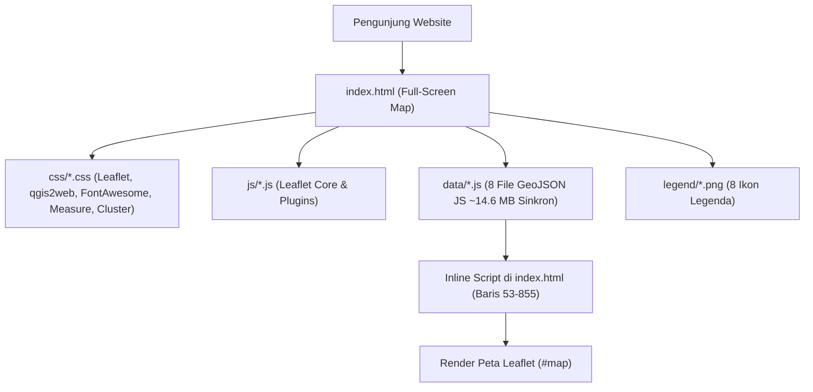
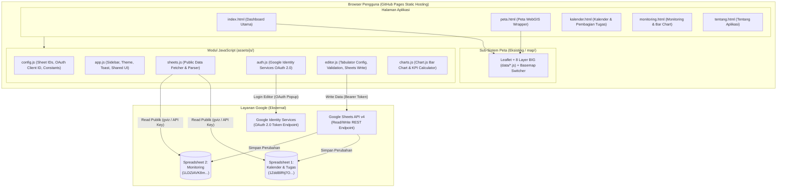
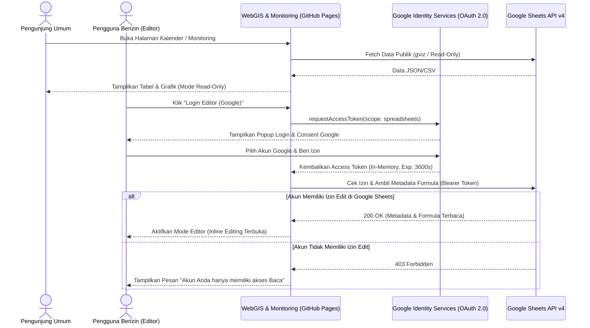
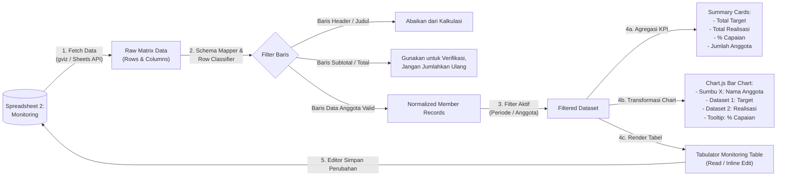
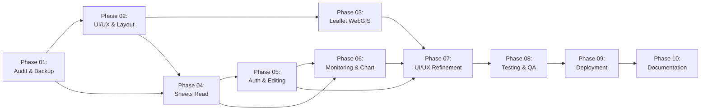

# ROADMAP PENGEMBANGAN: WEBGIS & MONITORING DASHBOARD KABUPATEN SITUBONDO

> **Status Dokumen:** Single Source of Truth (Versi 1.1 — Phase 01 Selesai & Skema Spreadsheet Terverifikasi)  
> **Tanggal Pembaruan Terakhir:** 2 November 2026  
> **Repository GitHub:** https://github.com/AdaniMaulidan/webgis-kabupaten-situbondo  
> **Production URL:** https://adanimaulidan.github.io/webgis-kabupaten-situbondo/  
> **Lingkungan Hosting:** GitHub Pages (Static Web Hosting)

---

## 1. Project Overview

**WebGIS & Monitoring Kabupaten Situbondo** adalah sistem informasi geospasial berbasis web dan dashboard pemantauan kegiatan yang dikembangkan dari hasil ekspor proyek QGIS (`qgis2web`) menggunakan data Badan Informasi Geospasial (BIG) Skala 1:25.000 wilayah Kabupaten Situbondo.

Tujuan utama transformasi proyek ini adalah meningkatkan aplikasi peta statis satu halaman (*single-page full-screen map*) menjadi **WebGIS & Monitoring Dashboard** terintegrasi yang modern, responsif, dan profesional. Aplikasi ini menggabungkan:
1. **Visualisasi Geospasial Interaktif:** Mempertahankan dan mengoptimalkan 8 layer utama data BIG Kabupaten Situbondo beserta fitur navigasi, *marker clustering*, *measurement tool*, dan *attribute popup*.
2. **Manajemen Kalender & Pembagian Tugas:** Integrasi dua arah (*read/write*) dengan Google Spreadsheet Kalender & Pembagian Tugas.
3. **Monitoring Kinerja & Visualisasi Grafik:** Integrasi dua arah (*read/write*) dengan Google Spreadsheet Monitoring serta visualisasi *Bar Chart* interaktif untuk memantau target, realisasi, dan persentase capaian setiap anggota secara *real-time*.

---

## 2. Current Project Status

Berdasarkan hasil inspeksi dan audit *source code* pada *workspace* lokal (`qgis2web_2026_11_02-01_29_03_226676`), kondisi proyek saat ini adalah sebagai berikut:

### A. Status Git & Repository (Diperbarui pada Phase 01)
- **Branch Aktif Saat Ini:** `develop` (dibuat dari `main` commit `74b5b9d` untuk mengisolasi pengembangan dari website produksi).
- **Branch Produksi:** `main` (tetap bersih dan sinkron dengan `origin/main` pada `https://github.com/AdaniMaulidan/webgis-kabupaten-situbondo.git`).
- **Tag Backup Git:** `v1.0-qgis2web-original` menunjuk ke commit `74b5b9d` (*Initial commit WebGIS Kabupaten Situbondo*).
- **File Backup Lokal:** `map-original-backup.html` (salinan identik dari `index.html` bawaan `qgis2web` sebagai titik pemulihan lokal).

### B. Kondisi Kode & Tampilan Saat Ini
- **Entry Point Tunggal:** `index.html` (857 baris kode, ukuran ~50,5 KB) yang berisi struktur HTML dasar, *inline script* konfigurasi peta Leaflet, fungsi *popup* per layer, serta definisi *styling* GeoJSON.
- **Tampilan UI:** Peta *full-screen* (`width: 100%; height: 100%`) tanpa *header*, *sidebar navigation*, *title* halaman (`<title></title>` masih kosong), maupun *basemap tile layer* (seperti OpenStreetMap/Citra Satelit) di latar belakang; latar belakang peta saat ini hanya warna putih (`background-color: #ffffff` pada `css/qgis2web.css`).
- **Fitur Peta Eksisting yang Berfungsi:**
  - *Zoom control* (`L.control.zoom`) di pojok kiri atas.
  - *Geolocation control* (`L.control.locate`).
  - *Measurement tool* (`L.Control.Measure`) dengan satuan meter/kilometer dan meter persegi/hektare.
  - *URL Hash* (`L.Hash`) untuk menyimpan koordinat dan level *zoom* pada URL.
  - *Layer tree control* (`L.control.layers.tree`) dalam kondisi *collapsed* di pojok kanan atas.
  - *Marker clustering* (`L.MarkerClusterGroup`) untuk 3 layer bertipe *Point* (`PEMERINTAHAN_PT_25K`, `PENDIDIKAN_PT_25K`, `SARANAIBADAH_PT_25K`).
  - *Popup* tabel atribut otomatis dengan penghapusan baris bernilai `null` (`removeEmptyRowsFromPopupContent`) dan dukungan media (`addClassToPopupIfMedia`).

### C. Inventarisasi Data Spasial Eksisting (`data/*.js`)
Seluruh data spasial disimpan sebagai variabel global JavaScript (`var json_<NAMA_LAYER> = {...}`) dengan sistem referensi koordinat `urn:ogc:def:crs:OGC:1.3:CRS84` dan dimuat secara sinkron (*blocking*) melalui tag `<script>` di `index.html`:

| No | Nama File | Nama Layer / Variabel JS | Tipe Geometri | Jumlah Fitur | Ukuran File | Simbologi Saat Ini |
| :--- | :--- | :--- | :--- | ---: | ---: | :--- |
| 1 | `ADMINISTRASIDESA_AR_25K_0.js` | `layer_ADMINISTRASIDESA_AR_25K_0` | Polygon (`AR`) | 194 | 2.266,8 KB | Fill `rgba(190,207,80,1.0)`, Stroke `#232323` |
| 2 | `AGRISAWAH_AR_25K_1.js` | `layer_AGRISAWAH_AR_25K_1` | Polygon (`AR`) | 177 | 1.471,3 KB | Fill `rgba(231,113,72,1.0)`, Stroke `#232323` |
| 3 | `PEMUKIMAN_AR_25K_2.js` | `layer_PEMUKIMAN_AR_25K_2` | Polygon (`AR`) | 1.170 | 1.528,4 KB | Fill `rgba(190,207,80,1.0)`, Stroke `#232323` |
| 4 | `SUNGAI_LN_25K_3.js` | `layer_SUNGAI_LN_25K_3` | LineString (`LN`) | 3.125 | 5.582,4 KB | Stroke `rgba(164,113,88,1.0)`, Weight `1.0` |
| 5 | `JALAN_LN_25K_4.js` | `layer_JALAN_LN_25K_4` | LineString (`LN`) | 1.866 | 3.554,1 KB | Stroke `rgba(229,182,54,1.0)`, Weight `1.0` |
| 6 | `PEMERINTAHAN_PT_25K_5.js` | `cluster_PEMERINTAHAN_PT_25K_5` | Point (`PT`) | 163 | 39,2 KB | CircleMarker `r=4`, Fill `rgba(114,155,111,1.0)` |
| 7 | `PENDIDIKAN_PT_25K_6.js` | `cluster_PENDIDIKAN_PT_25K_6` | Point (`PT`) | 180 | 54,9 KB | CircleMarker `r=4`, Fill `rgba(141,90,153,1.0)` |
| 8 | `SARANAIBADAH_PT_25K_7.js` | `cluster_SARANAIBADAH_PT_25K_7` | Point (`PT`) | 426 | 97,5 KB | CircleMarker `r=4`, Fill `rgba(255,158,23,1.0)` |
| **Total** | **8 File Data** | **8 Layer Utama** | **Mixed** | **7.301** | **~14.594,6 KB** | **Default qgis2web** |

> **Temuan Teknis Penting pada Data Spasial:**
> 1. Total ukuran file `.js` data spasial adalah **~14,6 MB** yang dimuat sekaligus saat halaman dibuka.
> 2. Simbologi `ADMINISTRASIDESA_AR_25K_0` dan `PEMUKIMAN_AR_25K_2` memiliki warna *fill* yang identik (`rgba(190,207,80,1.0)`), sehingga sulit dibedakan secara visual tanpa penyesuaian opasitas/warna.
> 3. *Popup* pada 5 layer (`ADMINISTRASIDESA`, `AGRISAWAH`, `PEMUKIMAN`, `SUNGAI`, `JALAN`) menampilkan nilai atribut dalam `<tr><td colspan="2">` tanpa label nama kolom (`<th>`), sedangkan 3 layer *Point* menampilkan `<th>NAMOBJ</th>` hanya untuk baris pertama.
> 4. Beberapa library JS bawaan ekspor `qgis2web` terdapat di folder `js/` namun tidak dipanggil di `index.html` (`leaflet-heat.js`, `Leaflet.VectorGrid.js`, `OSMBuildings-Leaflet.js`, `leaflet.wms.js`, `leaflet-tilelayer-wmts.js`, `leaflet-svg-shape-markers.min.js`, `multi-style-layer.js`). File-file tersebut tetap dipertahankan agar tidak merusak integritas ekspor asli.

---

## 3. Project Goals and Scope

### A. Tujuan Pengembangan (Goals)
1. Membangun antarmuka **Modern WebGIS & Monitoring Dashboard** dengan tema warna profesional (Biru Tua `#0F172A` / `#1E3A8A`, Putih `#FFFFFF`, Abu-abu Terang `#F8FAFC`, dan Aksen Hijau `#10B981`).
2. Menyediakan struktur navigasi multi-halaman yang terorganisir: **Dashboard**, **Peta WebGIS**, **Kalender dan Pembagian Tugas**, **Monitoring**, dan **Tentang Aplikasi**.
3. Mengintegrasikan pembacaan data langsung (*live read*) dari dua Google Spreadsheet utama tanpa perlu mengubah kode dan *re-deploy* saat data spreadsheet berubah.
4. Menyediakan fitur pengeditan data langsung (*in-app table editing*) pada halaman Kalender dan Monitoring khusus bagi pengguna berizin (*authorized editors*) menggunakan autentikasi Google OAuth 2.0, dengan perlindungan penuh terhadap sel rumus (*formula*) dan struktur tabel.
5. Menampilkan visualisasi *Bar Chart* interaktif dan kartu ringkasan (*summary cards*) kinerja anggota berdasarkan data riil dari Spreadsheet Monitoring.

### B. Batasan Proyek (Scope)
- **Dalam Cakupan (In-Scope):**
  - Transformasi UI/UX seluruh halaman menggunakan HTML5, CSS3 modular, dan JavaScript ES6+.
  - Pelestarian dan peningkatan tampilan 8 layer BIG Kabupaten Situbondo pada peta Leaflet.
  - Integrasi baca/tulis Google Sheets API v4 & Google Identity Services (GIS) OAuth 2.0 di sisi *client* (kompatibel penuh dengan GitHub Pages).
  - *Interactive data table* (pencarian, filter, *sorting*, *inline editing*, validasi) dan grafik *Bar Chart* responsif.
- **Di Luar Cakupan (Out-of-Scope):**
  - Pembuatan server *backend* khusus (Node.js/Python/PHP) atau database eksternal (PostgreSQL/MySQL) di luar ekosistem Google Sheets & GitHub Pages.
  - Pengubahan geometri asli data Shapefile/GeoJSON BIG Kabupaten Situbondo.
  - Pembuatan ulang proyek dari nol dengan *framework* berat (React/Next.js/Vue) yang mengubah arsitektur dasar *static site*.

---

## 4. Functional Requirements

| ID | Modul | Kebutuhan Fungsional | Prioritas |
| :--- | :--- | :--- | :--- |
| **FR-01** | **Navigasi & Layout** | Sistem memiliki *Sidebar Navigation* yang dapat di-*toggle* (desktop & mobile) dan *Top Header* yang menampilkan judul halaman, status sinkronisasi data, serta tombol Login/Profil Editor. | Wajib |
| **FR-02** | **Dashboard** | Menampilkan *Summary Cards* (Total Target, Total Realisasi, Persentase Capaian, Jumlah Anggota), *Bar Chart* capaian per anggota, *mini-preview* Peta WebGIS, dan ringkasan jadwal/aktivitas terkini. | Wajib |
| **FR-03** | **Peta WebGIS** | Menampilkan peta interaktif Kabupaten Situbondo dengan 8 layer BIG, kontrol layer (*layer tree*), pilihan *basemap* (OSM, Satelit, Terrain, Tanpa Basemap), *marker clustering*, *measurement tool*, *geolocation*, pencarian objek/desa, legenda yang jelas, dan *popup* atribut yang rapi dengan label nama atribut. | Wajib |
| **FR-04** | **Kalender & Tugas** | Membaca dan menampilkan data dari **Spreadsheet 1 (Kalender & Pembagian Tugas)** dalam bentuk tampilan kalender/jadwal kegiatan dan tabel interaktif dengan fitur pencarian serta filter. | Wajib |
| **FR-05** | **Monitoring** | Membaca dan menampilkan data dari **Spreadsheet 2 (Monitoring)** dalam tabel interaktif lengkap dengan kolom Target, Realisasi, Persentase Capaian, filter anggota/periode, dan *Bar Chart* capaian anggota. | Wajib |
| **FR-06** | **Autentikasi Editor** | Menyediakan fitur Login menggunakan akun Google (Google Identity Services OAuth 2.0) untuk membedakan pengunjung umum (*Read-Only*) dan pengguna berizin (*Authorized Editor*). | Wajib |
| **FR-07** | **Pengeditan Spreadsheet** | Pengguna berizin dapat mengedit sel data yang diizinkan langsung dari tabel di halaman Kalender dan Monitoring, melakukan validasi input, menyimpan perubahan kembali ke Google Sheets asli, dan memuat ulang (*re-fetch*) data terbaru secara otomatis. | Wajib |
| **FR-08** | **Proteksi Rumus** | Sistem mengunci (*read-only*) kolom yang berisi rumus perhitungan otomatis (misalnya Persentase Capaian, Subtotal/Total, atau ID unik) agar tidak tertimpa nilai statis saat diedit melalui web. | Wajib |
| **FR-09** | **Tentang Aplikasi** | Menampilkan informasi profil proyek WebGIS & Monitoring Kabupaten Situbondo, tujuan sistem, daftar 8 sumber data spasial BIG, arsitektur teknologi, dan panduan singkat penggunaan. | Wajib |

---

## 5. Non-Functional Requirements

1. **Performance (Performa):**
   - Halaman non-peta (`index.html` Dashboard, `kalender.html`, `monitoring.html`, `tentang.html`) harus dimuat dengan cepat (< 2 detik pada koneksi standar) tanpa dibebani pemuatan file GeoJSON sebesar ~14,6 MB secara penuh apabila tidak diperlukan.
   - Pada halaman Peta WebGIS, pemuatan GeoJSON dilengkapi dengan *loading overlay/spinner* yang informatif agar pengguna mengetahui proses *rendering* 7.301 fitur sedang berlangsung.
2. **Security (Keamanan):**
   - **Zero Secret Exposure:** Tidak boleh ada *Client Secret*, *Service Account Private Key*, atau token permanen di dalam kode sumber maupun riwayat Git.
   - Menggunakan *OAuth 2.0 Implicit/Token Flow* via Google Identity Services (GIS) yang hanya menggunakan *Public Client ID* dan memvalidasi izin tulis langsung melalui mekanisme ACL (*Access Control List*) bawaan Google Sheets.
3. **Usability & Accessibility (Kemudahan Penggunaan & Aksesibilitas):**
   - Antarmuka *clean*, kontras teks memenuhi standar keterbacaan (WCAG AA), atribut `aria-label` pada tombol ikon, serta navigasi *keyboard* dasar pada tabel dan form.
   - Dilengkapi *loading skeleton/spinner*, *empty state* (jika pencarian tidak ditemukan), dan *toast notification* untuk pesan sukses/error.
4. **Responsiveness (Responsivitas):**
   - Mendukung layar Desktop (`>= 1024px`), Tablet (`768px - 1023px`), dan Smartphone (`< 768px`) dengan tata letak *grid/flexbox* adaptif dan *collapsible sidebar drawer*.
5. **Maintainability (Kemudahan Pemeliharaan):**
   - Pemisahan yang tegas antara file ekspor asli `qgis2web` dengan kode aplikasi dashboard baru (*Separation of Concerns*).
   - Seluruh konfigurasi ID Spreadsheet, nama *sheet/range*, dan OAuth Client ID ditempatkan terpusat pada satu modul konfigurasi (`assets/js/config.js`).

---

## 6. Technology Stack

Teknologi dipilih dengan memprioritaskan kompatibilitas penuh terhadap **GitHub Pages** (arsitektur statis tanpa *backend server* tambahan):

### A. Frontend Core
- **HTML5 Semantic Markup:** Struktur halaman standar untuk 5 halaman utama.
- **CSS3 Custom Properties (Variables), Flexbox & CSS Grid:** Sistem desain modular (`style.css` dan `responsive.css`) tanpa ketergantungan *build step* yang rumit.
- **JavaScript (ES6+ Modules):** Logika aplikasi modular, *async/await*, `fetch` API.
- **Google Fonts (`Inter` / `Plus Jakarta Sans`):** Tipografi modern untuk antarmuka dashboard dan tabel data.
- **Lucide Icons (via CDN) & FontAwesome 5 (Lokal):** Ikon antarmuka dashboard yang ringan dan konsisten, dipadukan dengan FontAwesome lokal bawaan `qgis2web` untuk kontrol peta.

### B. WebGIS & Spatial Engine (Existing + Enhanced)
- **Leaflet.js (Lokal `js/leaflet.js`):** Engine utama peta interaktif.
- **Plugin Leaflet Eksisting (Lokal `js/`):**
  - `leaflet.markercluster.js` (Clustering titik fasilitas).
  - `leaflet-measure.js` (Pengukuran jarak dan luas).
  - `L.Control.Layers.Tree.min.js` (Manajemen layer hierarkis).
  - `L.Control.Locate.min.js` (Pelacakan lokasi pengguna).
  - `leaflet-hash.js` (Sinkronisasi state koordinat di URL).
  - `Autolinker.min.js`, `rbush.min.js`, `labelgun.min.js` (Format tautan popup & penataan label).

### C. Data Visualization & Interactive Table
- **Chart.js (v4.x via CDN):** Pembuatan *Bar Chart* capaian anggota yang interaktif, responsif, mendukung *tooltip* kustom, dan *dynamic dataset update*.
- **Tabulator (v6.x via CDN):** Library tabel interaktif modern yang mendukung *inline cell editing*, validasi input per kolom, *filtering*, *multi-column sorting*, *pagination*, *frozen columns*, dan penandaan sel yang telah diubah (*dirty cells*).
  - *Alasan pemilihan Tabulator:* Tidak memerlukan React/jQuery, kompatibel langsung dengan Vanilla JS di GitHub Pages, serta memiliki fitur `editable` per kolom dan *callback* `cellEdited` yang sangat cocok untuk sinkronisasi ke Google Sheets.

### D. Data Source & Authentication Integration
- **Google Sheets Visualization API (`gviz/tq`) / CSV Export / Sheets API v4:** Untuk pembacaan data publik (*Read-Only*) secara cepat bagi seluruh pengunjung.
- **Google Identity Services (GIS) SDK (`https://accounts.google.com/gsi/client`):** Untuk alur login OAuth 2.0 di browser (*Token Model*) tanpa memerlukan *backend server*.
- **Google Sheets REST API v4 (`https://sheets.googleapis.com/v4/spreadsheets/...`):** Untuk pembacaan metadata terstruktur dan penyimpanan perubahan (*batchUpdate* / *values.update*) menggunakan *Access Token* milik pengguna editor yang sedang login.

---

## 7. Existing Architecture

Saat ini proyek memiliki arsitektur monolitik satu halaman hasil generate otomatis plugin `qgis2web`:



### Kelemahan Arsitektur Eksisting:
1. **Tightly Coupled:** Seluruh definisi *style*, *popup template*, dan inisialisasi peta berada di dalam satu blok `<script>` sepanjang ~800 baris di `index.html`.
2. **Blocking Load:** Setiap kali membuka `index.html`, browser wajib mengunduh dan mem-parsing ~14,6 MB file JavaScript GeoJSON sebelum peta dapat berinteraksi.
3. **Tidak Ada Navigasi & Modul Monitoring:** Belum memiliki pemisahan halaman untuk Dashboard, Kalender, Monitoring, maupun modul koneksi ke Google Spreadsheet.
4. **Ketiadaan Basemap:** Peta hanya menampilkan poligon/garis/titik di atas kanvas putih tanpa peta dasar referensi.

---

## 8. Proposed Architecture

Arsitektur baru mempertahankan keutuhan aset peta `qgis2web` sembari membungkusnya ke dalam arsitektur **Multi-Page Modular Static Web Application** yang di-hosting di GitHub Pages:



### Keunggulan Arsitektur Baru:
1. **Keamanan Tanpa Backend:** Tidak ada kredensial rahasia di dalam kode sumber. Hak akses tulis sepenuhnya diverifikasi oleh Google berdasarkan akun Google yang login dan daftar izin berbagi (*Share Permissions*) pada kedua file Google Spreadsheet.
2. **Isolasi Beban Data Spasial:** Halaman `kalender.html`, `monitoring.html`, dan `tentang.html` tidak perlu memuat 14,6 MB data GeoJSON sehingga waktu muat halaman sangat instan.
3. **Non-Destructive GIS Integration:** Kode asli hasil ekspor `qgis2web` tetap terjaga fungsionalitasnya dan hanya ditingkatkan (*enhanced*) dengan kontrol *basemap*, legenda yang lebih informatif, serta integrasi tata letak dashboard.

---

## 9. UI/UX and Page Structure

### A. Design System & Tema Visual
- **Palet Warna Utama:**
  - *Primary Dark (Sidebar & Header Accent):* `#0F172A` (Slate 900) dan `#1E3A8A` (Deep Navy Blue).
  - *Primary Brand:* `#2563EB` (Royal Blue) untuk elemen interaktif aktif.
  - *Accent / Success:* `#10B981` (Emerald Green) untuk indikator capaian tinggi, tombol simpan, dan status aktif.
  - *Warning & Danger:* `#F59E0B` (Amber) untuk capaian menengah/perhatian, `#EF4444` (Red) untuk capaian rendah/pesan kesalahan.
  - *Background & Surface:* `#F8FAFC` (App Background), `#FFFFFF` (Card/Panel Surface), `#E2E8F0` (Border).
  - *Typography:* `#0F172A` (Heading/Primary Text), `#475569` (Secondary Text), `#94A3B8` (Muted Text).
- **Komponen UI Standar:**
  - *Sidebar Navigation:* Lebar `260px` pada desktop (dapat diciutkan menjadi `72px` *icon-only*), otomatis menjadi *off-canvas drawer* pada layar mobile/tablet.
  - *Top Navbar:* Tinggi `64px`, menampilkan *breadcrumb* / judul halaman aktif, indikator waktu sinkronisasi terakhir (*Last Synced*), tombol *Refresh Data*, serta status autentikasi (*Badge Mode Lihat* vs *Mode Editor Aktif*).

### B. Rincian Struktur 5 Halaman Utama

#### 1. Halaman Dashboard (`index.html`)
- **Baris 1 — Summary KPI Cards (4 Kartu):**
  1. **Total Target:** Akumulasi target kegiatan/pekerjaan dari Spreadsheet Monitoring.
  2. **Total Realisasi:** Akumulasi realisasi yang telah dicapai.
  3. **Persentase Capaian:** Persentase agregat $\left(\frac{\text{Total Realisasi}}{\text{Total Target}} \times 100\%\right)$ dengan *progress bar* warna dinamis.
  4. **Jumlah Anggota / Kegiatan Aktif:** Total personel yang tercatat dalam monitoring beserta ringkasan tugas aktif dari Spreadsheet Kalender.
- **Baris 2 — Visualisasi Utama (Grid 2 Kolom: 65% : 35%):**
  - **Kolom Kiri:** **Bar Chart Capaian Anggota** (Target vs Realisasi & Persentase per anggota) dilengkapi filter cepat dan tombol menuju halaman Monitoring penuh.
  - **Kolom Kanan:** **Preview Peta WebGIS Situbondo** (peta interaktif ringkas atau *interactive card* dengan ringkasan 8 layer BIG dan tombol *"Buka Peta Layar Penuh"*).
- **Baris 3 — Ringkasan Jadwal & Aktivitas Terkini:**
  - Daftar/tabel ringkas jadwal kegiatan terdekat dari Spreadsheet Kalender & Pembagian Tugas.

#### 2. Halaman Peta WebGIS (`peta.html`)
- Menyediakan tampilan peta interaktif Kabupaten Situbondo dalam area kerja dashboard yang optimal (*full-height content area*).
- **Fitur Peningkatan UI Peta:**
  - *Toolbar* cepat di atas peta: *Reset Extent* (Kembali ke batas Kabupaten Situbondo), *Toggle Fullscreen*, Pencarian Desa (`NAMOBJ` pada `ADMINISTRASIDESA_AR_25K`), dan Pemilih *Basemap* (OpenStreetMap, Google Satellite/Esri World Imagery, Carto Positron, atau Latar Putih).
  - Mempertahankan seluruh 8 layer BIG, *Layer Tree Control*, *Marker Clustering*, *Locate Control*, dan *Measurement Tool*.
  - Perbaikan tampilan *Popup* agar menampilkan nama atribut yang mudah dibaca (misalnya `NAMOBJ` ditampilkan sebagai **Nama Objek / Desa**, `REMARK` sebagai **Keterangan**, `WADMKC` sebagai **Kecamatan**).

#### 3. Halaman Kalender dan Pembagian Tugas (`kalender.html`)
- **Header Kontrol:** Kotak pencarian (*global search*), filter berdasarkan anggota/status/bulan (menyesuaikan struktur worksheet), tombol *Refresh*, serta tombol **Login Editor / Mode Edit**.
- **Tampilan Visual Kalender / Jadwal:** Ringkasan agenda/jadwal kegiatan dan distribusi tugas per anggota.
- **Tabel Interaktif (Tabulator):** Menampilkan seluruh baris data dari Spreadsheet 1.
- **Panel Editor (Aktif setelah Login OAuth):** Memungkinkan pengeditan langsung pada sel yang diizinkan, indikator baris yang dimodifikasi, tombol **Simpan ke Google Sheets**, dan tombol **Batal (Discard Changes)**.

#### 4. Halaman Monitoring (`monitoring.html`)
- **Header & Filter Bar:** Filter berdasarkan Nama Anggota, Periode/Bulan (apabila tersedia di spreadsheet), dan kategori capaian.
- **KPI Mini-Bar:** Ringkasan statistik sesuai filter yang sedang aktif.
- **Bagian Grafik (Bar Chart Utama):**
  - Grafik batang (*Bar Chart* Chart.js) yang membandingkan **Target** dan **Realisasi** serta menampilkan **Persentase Capaian (%)** setiap anggota.
  - Opsi mode grafik: *Grouped Bar (Target vs Realisasi)* atau *Percentage Ranking Bar (% Capaian)*.
- **Bagian Tabel Monitoring Interaktif (Tabulator):**
  - Menampilkan data detail dari Spreadsheet 2.
  - Dilengkapi *progress bar* visual di dalam sel kolom capaian.
  - Mendukung *inline editing* bagi pengguna berizin untuk memperbarui angka Target/Realisasi, yang setelah disimpan akan otomatis menghitung ulang dan memperbarui *Bar Chart* di atasnya.

#### 5. Halaman Tentang Aplikasi (`tentang.html`)
- Penjelasan latar belakang dan tujuan **WebGIS & Monitoring Kabupaten Situbondo**.
- Katalog 8 Layer Data Geospasial BIG Skala 1:25.000 beserta penjelasan atribut dan jenis geometrinya.
- Arsitektur teknologi dan panduan penggunaan (cara bernavigasi di peta, cara memfilter data, serta prosedur login dan edit data bagi anggota/admin berizin).

---

## 10. Google Sheets Integration Strategy

### A. Identitas Kedua Spreadsheet Target

1. **Spreadsheet 1 — Kalender dan Pembagian Tugas**
   - **URL:** `https://docs.google.com/spreadsheets/d/1ZddBlRtj7OZyS3VmiisQtV7gJbekAxrq6YfxvD-liUY/edit?gid=670201195`
   - **Spreadsheet ID:** `1ZddBlRtj7OZyS3VmiisQtV7gJbekAxrq6YfxvD-liUY`
   - **Target GID (Worksheet ID):** `670201195`
2. **Spreadsheet 2 — Monitoring**
   - **URL:** `https://docs.google.com/spreadsheets/d/1LDZiAVK8mDlRiLqayorNHAcwtu3H-msn970lYvicjzo/edit?usp=sharing`
   - **Spreadsheet ID:** `1LDZiAVK8mDlRiLqayorNHAcwtu3H-msn970lYvicjzo`
   - **Target GID (Worksheet ID):** Default (`0` atau sesuai tab pertama/utama pada dokumen).

### B. Hasil Verifikasi Struktur Kedua Spreadsheet (TERVERIFIKASI PADA PHASE 01)

Berdasarkan inspeksi langsung pada metadata `htmlview`, endpoint `gviz/tq`, dan ekspor CSV kedua Google Spreadsheet pada Phase 01, kedua dokumen **dapat diakses secara publik untuk pembacaan (`200 OK`)** dan memiliki struktur riil sebagai berikut:

#### 1. Struktur Detail Spreadsheet 1 — Kalender dan Pembagian Tugas (`1ZddBlRtj7OZyS3VmiisQtV7gJbekAxrq6YfxvD-liUY`)

Dokumen ini memiliki **10 Worksheet (Tab)**:

| No | Nama Worksheet (Tab) | `gid` | Fungsi & Isi |
| :---: | :--- | :--- | :--- |
| 1 | `Kalender Survei` | `0` | Matriks kalender visual 6 bulan (**Oktober 2026 – Maret 2027**) berisi jadwal survei & digitasi per kecamatan serta hari libur nasional. |
| 2 | `Copy of Kec.Situbondo` | `368658062` | Salinan cadangan tab `Kec.Situbondo`. |
| 3 | `Kec.Situbondo` | `670201195` | **Tab Utama Pembagian Tugas Kecamatan Situbondo** (sesuai URL pada spesifikasi proyek). |
| 4 | `Kec.Panji` | `1079740225` | Tabel Pembagian Tugas Kecamatan Panji (02–05 November 2026). |
| 5 | `Kec.Mangaran` | `1319029332` | Tabel Pembagian Tugas Kecamatan Mangaran. |
| 6 | `Kec.Kapongan` | `86010589` | Tabel Pembagian Tugas Kecamatan Kapongan. |
| 7 | `Kec.Arjasa` | `1378660540` | Tabel Pembagian Tugas Kecamatan Arjasa. |
| 8 | `Kec.Kendit` | `642836605` | Tabel Pembagian Tugas Kecamatan Kendit. |
| 9 | `Kec.Panarukan` | `523754395` | Tabel Pembagian Tugas Kecamatan Panarukan. |
| 10 | `Kec.Bungatan` | `1872022630` | Tabel Pembagian Tugas Kecamatan Bungatan. |

**Skema Baris & Kolom pada Tab Pembagian Tugas (`Kec.Situbondo` `gid=670201195` & Kecamatan Lainnya):**
- **Baris 1:** Judul Tabel pada `Col B` (`Tabel Kegiatan Survei Lapangan`).
- **Baris 2–3:** Baris kosong (*spacer rows*).
- **Baris 4:** **Baris Header Tabel Utama** (`parsedNumHeaders: 4` pada `gviz`).
- **Baris 5–36:** **Baris Data (32 baris = 4 Kelompok Hari Survei × 8 Anggota Tim)**:
  - `Col A`: Kosong (margin kiri).
  - `Col B` (`No`): Nomor kelompok hari survei (`1`, `2`, `3`, `4`). Hanya terisi pada baris pertama dari setiap blok 8 anggota (di-*merge* vertikal untuk 8 baris).
  - `Col C` (`PIC`): Nama Penanggung Jawab Kecamatan (misal `Adinda Nike Febiyanti` pada `Kec.Situbondo`, `Aji Dwi Jatmiko` pada `Kec.Panji`). Di-*merge* vertikal.
  - `Col D` (`Nama Anggota`): Nama 8 anggota tim yang selalu berulang secara berurutan di setiap kelompok `No`:
    1. `Adinda Martha Putri Andristi`
    2. `Adinda Nike Febiyanti`
    3. `Aji Dwi Jatmiko`
    4. `Tiara Puspita Sari`
    5. `Hafihud Thohir`
    6. `Wildatul Fajariyah`
    7. `Muhammad Adani Maulidan`
    8. `Nabiela Fadin Insani Jannah Putri Sinarwadi`
  - `Col E` (`Kegiatan`): Nama kegiatan (misal `Survei Lokasi Bidang Tanah Wakaf`), di-*merge* vertikal per kelompok `No`.
  - `Col F` (`Tanggal`): Tanggal pelaksanaan (misal `26 Oktober 2026` s/d `29 Oktober 2026`), di-*merge* vertikal per kelompok `No`.
  - `Col G` (`Kecamatan`): Nama kecamatan (misal `Kecamatan Situbondo`), di-*merge* vertikal per kelompok `No`.
  - `Col H` (`Desa/Kelurahan`): Desa target survei (misal `Dawuhan`, `Patokan`, `Kotakan & Kalibagor`, `Talkandang & Olean`), di-*merge* vertikal per kelompok `No`.
  - `Col I` (`Total Bidang`): Informasi jumlah bidang berbentuk teks deskriptif (misal `19 Bidang`, `27 Bidang`, `Kotakan : 11 Bidang + 4 Bidang Persil = 15 Bidang`, `Kalibagor : 7 Bidang + 21 Bidang Persil = 28`). **Catatan Penting:** Kolom ini berupa teks deskriptif dan pada hari dengan 2 desa dipecah pada baris ke-1 dan baris ke-5 dalam blok 8 anggota.
  - `Col J` (`Pembagian`): Rincian pembagian bidang per anggota (misal `Belum Bersertifikat No 32 & No 33`, `Hak Milik No 9 & No 11`, atau keterangan jumlah personel `3 org`, `2 orang`). **Kolom ini adalah kolom utama yang diedit per baris anggota.**
  - `Col K` (`Link`): Tautan Google My Maps (`https://www.google.com/maps/d/...`) untuk lokasi survei desa terkait.

---

#### 2. Struktur Detail Spreadsheet 2 — Monitoring (`1LDZiAVK8mDlRiLqayorNHAcwtu3H-msn970lYvicjzo`)

Dokumen ini memiliki **4 Worksheet (Tab) Periode Bulanan**:

| No | Nama Worksheet (Tab) | `gid` | Fungsi & Isi |
| :---: | :--- | :--- | :--- |
| 1 | `Bulan 1` | `0` | Monitoring Mingguan (`Minggu ke- 1` s/d `4`) untuk Bulan 1. |
| 2 | `Bulan 2` | `1983116596` | Monitoring Mingguan (`Minggu ke- 1` s/d `4`) untuk Bulan 2. |
| 3 | `Bulan 3` | `755707223` | Monitoring Mingguan (`Minggu ke- 1` s/d `4`) untuk Bulan 3. |
| 4 | `Bulan 4` | `1304782040` | Monitoring Mingguan (`Minggu ke- 1` s/d `4`) untuk Bulan 4. |

**Skema Baris & Kolom pada `Bulan 1` (`gid=0`):**
- **Baris 1:** **Baris Header Tabel Utama** (`parsedNumHeaders: 1` pada `gviz`):
  - `Col A` (`Minggu ke-`): Nomor minggu (`1`, `2`, `3`, `4`). Hanya tertulis pada baris pertama setiap blok 8 anggota (Baris 2 = Minggu 1, Baris 10 = Minggu 2, Baris 18 = Minggu 3, Baris 26 = Minggu 4).
  - `Col B` (`Tanggal Mulai`): Rentang tanggal minggu terkait (misal `09/26/2026 - 09/29/2026` pada Minggu ke-1).
  - `Col C` (`Nama `): Nama 8 anggota tim per minggu.
    - **Temuan Kritis Normalisasi Nama:** Pada Spreadsheet 2, nama `Aji Dwi Jatmiκο` menggunakan 2 karakter Yunani Unicode di akhir (`\u03ba\u03bf` *kappa-omicron*) dan nama `Nabiela Fadin Insani J P S` disingkat, serta beberapa sel memiliki spasi di awal (`" Nabiela..."` pada `Bulan 2`). Parser di `sheets.js` wajib melakukan `trim()` dan normalisasi nama anggota agar sinkron 100% antar-minggu dan antar-spreadsheet!
  - `Col D` (`Kegiatan`): Nama kegiatan mingguan (misal `Survei Bidang Wakaf di Kecamatan Situbondo`).
  - `Col E` (`Target Yang Dicapai Minggu Ini`): Kolom input realisasi/target capaian minggu berjalan.
  - `Col F` (`Target Yang Akan Dicapai Minggu Depan`): Kolom rencana target minggu depan.
  - `Col G` (`Capaian (%)`): Kolom persentase capaian (`0–100%`).
  - `Col H` (`Status`): Status pencapaian mingguan (pada `Bulan 1` Minggu ke-1, seluruh 8 anggota telah berstatus `"Tercapai"`).
  - `Col I` (`Target Yang Akan Dicapai Minggu Berikutnya`): Kolom tambahan rencana berikutnya (ada pada `Bulan 1`, sedangkan pada `Bulan 2` kolom ini ditiadakan sehingga `Catatan Mentor` bergeser ke `Col I`).
  - `Col J` (`Catatan Mentor`): Catatan evaluasi mentor (berada di `Col J` pada `Bulan 1`, dan `Col I` pada `Bulan 2`).

**Implikasi Penting Hasil Audit terhadap Parser & Pengeditan (`sheets.js`, `editor.js`, `charts.js`):**
1. **Forward-Fill untuk Sel Gabungan Vertikal (`Merged Cells`):** Saat membaca tabel ke antarmuka web, nilai `No`, `PIC`, `Kegiatan`, `Tanggal`, `Kecamatan`, `Desa/Kelurahan` (di Spreadsheet 1) dan `Minggu ke-` (di Spreadsheet 2) akan di-*forward-fill* di memori agar setiap baris anggota dapat difilter/dicari dengan sempurna. Namun, saat menyimpan editan ke Google Sheets, sistem tetap memetakan ke nomor baris asli (`_sheetRowIndex`) tanpa menimpa struktur sel gabungan.
2. **Pemilih Tab Worksheet (Multi-Tab Selector):**
   - Halaman **Kalender & Pembagian Tugas** akan menyediakan tab/pemilih untuk melihat visual **Kalender Survei (`gid=0`)** maupun memilih **Kecamatan (`Kec.Situbondo`, `Kec.Panji`, `Kec.Mangaran`, dst.)**.
   - Halaman **Monitoring** akan menyediakan filter pemilih **Periode Bulan (`Bulan 1` s/d `Bulan 4`)** dan **Minggu (`Minggu 1` s/d `Minggu 4`)**.
3. **Logika Kalkulasi Capaian & Bar Chart:**
   - Apabila kolom `Capaian (%)` (`Col G`) berisi angka eksplisit (misalnya `85` atau `100%`), grafik menggunakan angka tersebut.
   - Apabila kolom `Capaian (%)` masih kosong namun kolom `Status` (`Col H`) sudah terisi `"Tercapai"` (seperti kondisi riil pada `Bulan 1` Minggu ke-1 saat ini), sistem mengenali minggu tersebut sebagai tercapai (`100%` untuk minggu berstatus `"Tercapai"`) sekaligus menghitung jumlah pembagian tugas/bidang per anggota dari Spreadsheet 1, sehingga *Bar Chart* dan *Summary Cards* langsung menampilkan data kinerja nyata dan dinamis begitu halaman dibuka maupun setelah nilai `Capaian (%)` / `Status` diedit!

### C. Strategi Teknis Pembacaan Data (Read Strategy)
Agar semua pengunjung website dapat melihat data tanpa harus login terlebih dahulu, digunakan pendekatan hibrida:
1. **Primary Public Read (Google Visualization API / JSONP / Fetch):**
   - Mengakses endpoint publik Google Sheets:
     `https://docs.google.com/spreadsheets/d/{SPREADSHEET_ID}/gviz/tq?tqx=out:json&gid={GID}`
   - *Keunggulan:* Tidak memerlukan login pengguna, mendukung pembacaan per `gid`, mengembalikan tipe data kolom (`string`, `number`, `date`) serta nilai terformat (`f`) dan nilai mentah (`v`).
2. **Authenticated Read (Google Sheets REST API v4 — Saat Editor Login):**
   - Ketika pengguna berizin login melalui OAuth 2.0, sistem memanggil:
     `GET https://sheets.googleapis.com/v4/spreadsheets/{SPREADSHEET_ID}?includeGridData=false` (untuk mendeteksi nama *sheet* dari `gid`) dan
     `GET https://sheets.googleapis.com/v4/spreadsheets/{SPREADSHEET_ID}/values/{SHEET_NAME}!A1:Z500?valueRenderOption=FORMATTED_VALUE` serta `valueRenderOption=FORMULA`.
   - *Keunggulan:* Dengan memeriksa `valueRenderOption=FORMULA`, aplikasi dapat mendeteksi secara otomatis sel mana saja yang diawali tanda `=` (rumus) sehingga sel tersebut otomatis dikunci (*read-only*) di tabel web!

---

## 11. Authentication and Authorization

Karena aplikasi di-hosting di **GitHub Pages** (murni *client-side static hosting*), arsitektur autentikasi dirancang agar **100% aman tanpa menyimpan rahasia di kode sumber**:



### Ketentuan Keamanan Autentikasi:
1. **OAuth 2.0 Client ID (Web Application):** Dikonfigurasi di Google Cloud Console dengan pembatasan **Authorized JavaScript Origins** khusus ke:
   - `https://adanimaulidan.github.io`
   - `http://localhost:5500` / `http://127.0.0.1:5500` (untuk pengujian lokal).
2. **Tanpa Client Secret di Repository:** Alur *Google Identity Services Token Model* (`google.accounts.oauth2.initTokenClient`) hanya membutuhkan `client_id` publik dan tidak menggunakan `client_secret`.
3. **Penyimpanan Token Sementara:** *Access Token* hanya disimpan di memori JavaScript (`sessionStorage` opsional selama tab terbuka) dan tidak pernah disimpan permanen di `localStorage` atau *cookie* lintas sesi demi mencegah penyalahgunaan.
4. **Otorisasi Berbasis ACL Asli Google Sheets:** Walaupun seseorang mencoba login dengan akun Google pribadinya, Google Sheets API akan menolak permintaan `PUT/POST` (`403 PERMISSION_DENIED`) apabila alamat email tersebut tidak terdaftar sebagai **Editor** pada pengaturan *Share* kedua Google Spreadsheet.

---

## 12. Spreadsheet Editing Strategy

Untuk memastikan pengeditan dari halaman WebGIS berjalan aman dan tidak merusak struktur asli Google Spreadsheet:

### A. Pemetaan Koordinat Sel (Row & Column Indexing)
- Setiap baris data yang dimuat ke dalam Tabulator diberi atribut metadata tersembunyi `_sheetRowIndex` yang merepresentasikan nomor baris asli pada Google Sheets (berbasis 1, misalnya baris ke-2, ke-3, dst.).
- Setiap kolom tabel dipetakan ke huruf kolom Google Sheets (`A`, `B`, `C`, dst.).
- Dengan demikian, ketika pengguna mengubah nilai pada baris ke-5 kolom `D`, sistem mengetahui target penyimpanannya secara presisi adalah sel `NamaSheet!D5`, **bukan** menimpa seluruh tabel.

### B. Proteksi Kolom Rumus, Merged Cells, dan Baris Total
1. **Deteksi Rumus Otomatis:** Saat mode editor diaktifkan, aplikasi membandingkan respons `valueRenderOption=FORMULA` dan `valueRenderOption=UNFORMATTED_VALUE`. Setiap sel/kolom yang nilainya diawali karakter `=` (seperti rumus `=C2/B2` atau `=SUM(...)`) ditandai dengan atribut `isFormula: true` dan dikunci (`editable: false`) dengan ikon gembok kecil.
2. **Deteksi Baris Subtotal / Total:** Baris yang teridentifikasi sebagai baris `JUMLAH`, `TOTAL`, `RATA-RATA`, atau `SUBTOTAL` dikecualikan dari pengeditan dan juga dikecualikan dari penjumlahan ulang di sisi aplikasi agar tidak terjadi perhitungan ganda (*double counting*).
3. **Penanganan Merged Cells:** Jika terdapat *merged cells* pada bagian judul/header atas spreadsheet, konfigurasi parser akan mengatur `headerRowIndex` pada baris header tabel yang sebenarnya, dan pengeditan hanya diizinkan pada rentang baris data detail (*data rows*).

### C. Alur Validasi, Penyimpanan, dan Pembacaan Ulang (Re-Read)
1. **Inline Edit & Dirty Tracking:** Saat editor mengubah nilai sel di Tabulator, sel diberi *highlight* kuning/hijau muda dan dicatat ke dalam antrean `pendingChanges`.
2. **Validasi Input:**
   - Kolom numerik (seperti Target dan Realisasi) divalidasi harus berupa angka non-negatif (`>= 0`).
   - Kolom tanggal/ teks divalidasi agar tidak merusak format yang diharapkan.
3. **Batch Update ke Google Sheets:**
   - Saat editor menekan tombol **"Simpan Perubahan"**, aplikasi menampilkan indikator *loading* dan mengirimkan `POST https://sheets.googleapis.com/v4/spreadsheets/{SPREADSHEET_ID}/values:batchUpdate` dengan `valueInputOption: "USER_ENTERED"`.
4. **Re-Read Otomatis:**
   - Segera setelah API mengembalikan status `200 OK`, sistem secara otomatis memanggil ulang fungsi pembacaan data (*re-fetch*) dari Google Sheets.
   - Langkah ini memastikan seluruh rumus di Google Sheets telah selesai dihitung ulang oleh mesin Google dan nilai hasil perhitungannya yang terbaru langsung ditampilkan di tabel serta *Bar Chart* website.

### D. Keterbatasan Teknis yang Dijelaskan Secara Eksplisit
- **Konflik Multi-User Bersamaan (Last-Write-Wins):** Google Sheets REST API menerapkan prinsip *last-write-wins* per sel. Untuk meminimalkan risiko timpa-menimpa jika ada dua editor membuka halaman bersamaan, aplikasi akan melakukan *granular cell update* (hanya mengirim sel yang benar-benar diedit, bukan mengirim ulang seluruh baris/tabel) dan menyediakan tombol *Refresh* sebelum mulai mengedit.
- **Formatting Visual Spreadsheet:** Pengeditan melalui halaman WebGIS berfokus pada pembaruan **nilai data (value)**, bukan mengubah warna latar sel, *border*, atau melakukan *merge/unmerge* sel baru di Google Sheets.

---

## 13. Monitoring and Bar Chart Data Flow

Alur pemrosesan data dari **Spreadsheet 2 (Monitoring)** menuju **Kartu KPI** dan **Bar Chart (Chart.js)** dirancang sebagai berikut:



### Aturan Kalkulasi & Visualisasi Bar Chart:
1. **Tanpa Data Palsu di Produksi:** Grafik pada mode produksi hanya merender data asli yang ditarik dari Spreadsheet Monitoring (`1LDZiAVK8mDlRiLqayorNHAcwtu3H-msn970lYvicjzo`).
2. **Pencegahan Double Counting:** Algoritma kalkulasi akan memeriksa setiap baris: baris yang tidak memiliki nama anggota valid atau memiliki label agregasi (`Total`, `Jumlah`, `Rata-rata`) tidak akan dimasukkan ke dalam array anggota pada *Bar Chart* maupun penjumlahan *Summary Cards*.
3. **Perhitungan Persentase Capaian:**
   - Jika spreadsheet sudah menyediakan kolom Persentase Capaian hasil rumus, nilai tersebut ditampilkan sesuai sumber.
   - Untuk agregat kartu ringkasan atau *fallback* perhitungan, digunakan rumus aman:
     $$\text{Persentase Capaian (\%)} = \begin{cases} \left(\frac{\text{Realisasi}}{\text{Target}} \times 100\right) & \text{jika } \text{Target} > 0 \\ 0\% & \text{jika } \text{Target} = 0 \end{cases}$$
4. **Interaktivitas Grafik:**
   - *Tooltip* saat kursor diarahkan ke batang anggota akan menampilkan: **Nama Anggota**, **Target**, **Realisasi**, **Selisih**, dan **Persentase Capaian (%)**.
   - Mendukung pengurutan grafik (misalnya: Urutkan berdasarkan Capaian Tertinggi, Capaian Terendah, atau Sesuai Urutan Spreadsheet).
   - Mendukung *Cache-Busting* (menambahkan parameter timestamp `&_t=${Date.now()}` saat *refresh* manual/setelah edit) agar perubahan di Google Sheets langsung tercermin di grafik tanpa menunggu *cache* browser kedaluwarsa.

---

## 14. Project Directory Structure

Berdasarkan audit repository saat ini, seluruh file `qgis2web` (`css/`, `data/`, `images/`, `js/`, `legend/`, `markers/`, `webfonts/`) berada langsung di *root directory*.

Untuk menjaga keamanan fungsi peta yang sudah berjalan dan menghindari kerusakan *relative path* pada ribuan baris kode di `data/*.js` dan `css/qgis2web.css`, kita memiliki **dua opsi strategi penataan folder** yang akan diputuskan pada Phase 02/03:

### Opsi A (Direkomendasikan — Non-Destructive Root Preservation + Modular `assets/`)
Membiarkan folder aset `qgis2web` (`data/`, `js/`, `css/`, `legend/`, `markers/`, `webfonts/`) tetap di posisinya saat ini agar tidak ada satu pun *relative path* internal `qgis2web` yang rusak, lalu memindahkan kode peta murni ke `peta.html` (atau `map/view.html`) dan menempatkan seluruh aset dashboard baru di dalam folder `assets/`:

```text
webgis-kabupaten-situbondo/
│
├── index.html                  # Halaman 1: Dashboard Utama (KPI, Bar Chart, Map Preview, Jadwal)
├── peta.html                   # Halaman 2: Peta WebGIS Kabupaten Situbondo (8 Layer BIG + UI Dashboard)
├── kalender.html               # Halaman 3: Kalender dan Pembagian Tugas (Tabel Interaktif + Editor)
├── monitoring.html             # Halaman 4: Monitoring Kinerja & Bar Chart (Tabel + Chart + Editor)
├── tentang.html                # Halaman 5: Tentang Aplikasi & Dokumentasi Sumber Data
├── roadmap.md                  # Dokumen Perencanaan & Pelacakan Progres Utama (Single Source of Truth)
├── README.md                   # Dokumentasi Repository GitHub
├── README.txt                  # File README asli bawaan ekspor qgis2web (dipertahankan)
│
├── assets/                     # [BARU] Seluruh kode & aset untuk Dashboard Modern
│   ├── css/
│   │   ├── style.css           # Design system, layout sidebar/navbar, cards, chart, tabel, modal
│   │   ├── map-custom.css      # Penyesuaian UI kontrol peta, basemap switcher, & popup rapi
│   │   └── responsive.css      # Breakpoints untuk Desktop, Tablet, dan Smartphone
│   │
│   ├── js/
│   │   ├── config.js           # Konfigurasi ID Spreadsheet, GID, OAuth Client ID, & mapping kolom
│   │   ├── app.js              # Logika navigasi sidebar, header, status koneksi, & notifikasi toast
│   │   ├── map-enhancer.js     # Tambahan basemap switcher, pencarian desa, & perbaikan label popup
│   │   ├── sheets.js           # Service pembacaan data Google Sheets (gviz JSON & Sheets API v4)
│   │   ├── auth.js             # Integrasi Google Identity Services (OAuth 2.0 Login/Logout/Token)
│   │   ├── editor.js           # Logika Tabulator inline-edit, proteksi formula, validasi, & batchUpdate
│   │   └── charts.js           # Inisialisasi & pembaruan dinamis Chart.js Bar Chart + kalkulasi KPI
│   │
│   └── img/                    # Ikon atau logo pendukung identitas visual Kabupaten Situbondo
│
├── css/                        # [EKSISTING - DIPERTAHANKAN] CSS bawaan qgis2web & Leaflet
├── data/                       # [EKSISTING - DIPERTAHANKAN] 8 File GeoJSON JS BIG Situbondo (~14.6 MB)
├── images/                     # [EKSISTING - DIPERTAHANKAN] Folder images bawaan qgis2web
├── js/                         # [EKSISTING - DIPERTAHANKAN] Library Leaflet & plugin bawaan qgis2web
├── legend/                     # [EKSISTING - DIPERTAHANKAN] 8 Ikon legenda layer (.png)
├── markers/                    # [EKSISTING - DIPERTAHANKAN] Folder markers bawaan qgis2web
└── webfonts/                   # [EKSISTING - DIPERTAHANKAN] FontAwesome webfonts bawaan qgis2web
```

> **Catatan Arsitektur Direktori:** Apabila diinginkan isolasi tambahan di dalam sub-folder `map/index.html`, hal tersebut juga dapat dilakukan dengan mengarahkan *path* `<script src="../data/...">` atau menyalin referensi path secara terukur. Opsi A di atas memiliki risiko regresi paling rendah karena seluruh *path* `legend/...`, `css/images/...`, dan `webfonts/...` tidak mengalami perubahan lokasi relatif terhadap root.

---

## 15. Detailed Development Roadmap — Phase 01 sampai Phase 10

Berikut adalah rincian rencana kerja dalam **10 Tahap Utama (Phases)**. Seluruh item menggunakan *checkbox* Markdown `- [ ]` yang hanya boleh diubah menjadi `- [x]` setelah tahap terkait selesai dikerjakan dan diverifikasi.

---

### Phase 01 — Project Audit & Backup

1. **Tujuan Tahap:**
   Mengamankan kondisi awal repository produksi (`main`), membuat *branch* pengembangan terpisah, melakukan cadangan (*backup*) `index.html` asli hasil `qgis2web`, serta memverifikasi akses dan struktur kolumnar kedua Google Spreadsheet.
2. **Prasyarat dan Dependency:**
   - Akses Git lokal pada *workspace*.
   - Akses baca ke URL Spreadsheet 1 (`1ZddBlRtj7OZyS3VmiisQtV7gJbekAxrq6YfxvD-liUY`) dan Spreadsheet 2 (`1LDZiAVK8mDlRiLqayorNHAcwtu3H-msn970lYvicjzo`).
3. **Daftar Tugas Teknis:**
   - [x] Memastikan *working tree* pada branch `main` bersih dan membuat branch pengembangan baru (`develop`) serta tag Git `v1.0-qgis2web-original` pada commit `74b5b9d`.
   - [x] Membuat salinan cadangan file `index.html` asli `qgis2web` (`map-original-backup.html`) agar konfigurasi asli 8 layer selalu memiliki titik pemulihan (*restore point*).
   - [x] Menginspeksi struktur **Spreadsheet 1 (Kalender & Pembagian Tugas)** dan mencatat ke-10 *worksheet*, baris header (baris ke-4), 11 kolom (`A–K`), blok *merged cells* 8 baris per kelompok `No`, serta kolom rincian pembagian dan tautan Google My Maps.
   - [x] Menginspeksi struktur **Spreadsheet 2 (Monitoring)** dan mencatat ke-4 *worksheet* (`Bulan 1` s/d `Bulan 4`), baris header (baris ke-1), 10 kolom (`A–J`), blok 8 anggota per `Minggu ke-` (`1–4`), serta kebutuhan normalisasi nama anggota.
   - [x] Memperbarui bagian skema data pada `roadmap.md` berdasarkan hasil inspeksi riil kedua spreadsheet.
4. **File yang Kemungkinan Dibuat atau Dimodifikasi:**
   - Modifikasi: `roadmap.md` (pembaruan hasil verifikasi skema spreadsheet).
   - Pembuatan: salinan cadangan `map-original-backup.html` dan tag Git `v1.0-qgis2web-original`.
5. **Output atau Deliverable:**
   - Branch pengembangan aktif (`develop`), tag/backup kode asli `qgis2web` (`v1.0-qgis2web-original` & `map-original-backup.html`), dan dokumentasi skema kolom kedua spreadsheet yang telah terverifikasi 100%.
6. **Acceptance Criteria:**
   - Branch `main` tidak tersentuh oleh perubahan eksperimental.
   - Struktur kolom kedua spreadsheet terdokumentasi secara akurat tanpa asumsi.
7. **Testing dan Validation:**
   - Cek `git status`, `git branch`, dan `git tag -l` memastikan berada di branch `develop` dengan tag `v1.0-qgis2web-original`.
   - Uji akses endpoint publik kedua spreadsheet (`gviz/tq`, `export?format=csv`, dan `htmlview`) berhasil mengembalikan status `200 OK` beserta struktur lengkap seluruh *worksheet*.
8. **Risiko serta Mitigasi:**
   - *Risiko:* Struktur *merged cells* vertikal (8 baris anggota per 1 nomor kelompok kegiatan/minggu) dan perbedaan ejaan karakter Unicode nama anggota (`Aji Dwi Jatmiκο`).
   - *Mitigasi:* Telah didokumentasikan pada Bab 10.B untuk ditangani dengan *forward-fill* metadata grup dan fungsi normalisasi nama anggota pada `sheets.js`.
9. **Status Pengerjaan:** `SELESAI (Diverifikasi pada 2 November 2026)`

---

### Phase 02 — UI/UX Design & Dashboard Architecture

1. **Tujuan Tahap:**
   Membangun pondasi tampilan visual (*Design System*), tata letak *Sidebar Navigation*, *Top Header*, *Summary Cards*, dan kerangka 5 halaman HTML (`index.html`, `peta.html`, `kalender.html`, `monitoring.html`, `tentang.html`) yang konsisten dan responsif.
2. **Prasyarat dan Dependency:**
   - Phase 01 selesai dilakukan.
3. **Daftar Tugas Teknis:**
   - [x] Membuat `assets/css/style.css` yang mendefinisikan variabel CSS (tema warna biru tua, putih, abu-abu terang, aksen hijau, tipografi, *spacing*, *shadows*, dan *border-radius*).
   - [x] Membuat `assets/css/responsive.css` untuk mengatur *breakpoints* tampilan desktop, tablet, dan smartphone (termasuk mekanisme *drawer sidebar* di layar kecil).
   - [x] Membuat modul `assets/js/config.js` untuk menyimpan konstanta aplikasi (Spreadsheet IDs, GIDs 10 tab Spreadsheet 1 dan 4 tab Spreadsheet 2, aturan normalisasi 8 anggota tim, dan katalog 8 layer BIG).
   - [x] Membuat modul `assets/js/app.js` untuk mengelola interaksi *sidebar toggle*, *active navigation state*, sistem *toast notification*, *modal/dialog*, dan indikator status pengguna (Mode Lihat vs Mode Editor).
   - [x] Menyusun kerangka halaman `index.html` (Dashboard), `peta.html` (Peta WebGIS), `kalender.html` (Kalender & Tugas), `monitoring.html` (Monitoring), dan `tentang.html` (Tentang Aplikasi) dengan navigasi yang saling terhubung.
4. **File yang Kemungkinan Dibuat atau Dimodifikasi:**
   - Dibuat: `assets/css/style.css`, `assets/css/responsive.css`, `assets/js/config.js`, `assets/js/app.js`, `peta.html`, `kalender.html`, `monitoring.html`, `tentang.html`.
   - Dimodifikasi: `index.html`.
5. **Output atau Deliverable:**
   - Kerangka aplikasi 5 halaman dengan desain dashboard modern yang dapat dinavigasi dengan lancar di desktop maupun mobile.
6. **Acceptance Criteria:**
   - Navigasi antar kelima halaman berfungsi tanpa *broken link*.
   - Tampilan konsisten mengikuti palet warna yang direkomendasikan.
   - Sidebar dapat dibuka/tutup dengan mulus pada ukuran layar mobile (`< 768px`) dan desktop.
7. **Testing dan Validation:**
   - Validasi sintaks JavaScript (`node --check`) pada `assets/js/config.js` dan `assets/js/app.js` lulus tanpa error (`0 errors`).
   - Verifikasi struktur DOM dan tautan navigasi pada kelima halaman HTML.
8. **Risiko serta Mitigasi:**
   - *Risiko:* Benturan *styling* CSS baru (`style.css`) dengan CSS bawaan `qgis2web.css` (misalnya aturan `html, body, #map { overflow: hidden; }` dan `.fa, a { color: #444444 !important; }` pada `css/qgis2web.css`).
   - *Mitigasi:* Mengisolasi pemanggilan `css/qgis2web.css` hanya pada halaman peta (`peta.html`) dan menggunakan *scoped class names* (`.app-sidebar`, `.app-header`, `.map-workspace-card`) untuk melindungi warna navigasi.
9. **Status Pengerjaan:** `SELESAI (Diverifikasi pada 2 November 2026)`

---

### Phase 03 — Leaflet WebGIS Integration

1. **Tujuan Tahap:**
   Mengintegrasikan peta interaktif Leaflet Kabupaten Situbondo beserta ke-8 layer BIG ke dalam halaman `peta.html` dan komponen *preview* pada `index.html` tanpa menghilangkan satu pun fungsionalitas asli, sekaligus meningkatkan kualitas visual dan informasinya.
2. **Prasyarat dan Dependency:**
   - Phase 02 selesai dilakukan.
3. **Daftar Tugas Teknis:**
   - [x] Memindahkan dan mengadaptasi inisialisasi peta Leaflet beserta ke-8 layer BIG (`ADMINISTRASIDESA_AR_25K`, `AGRISAWAH_AR_25K`, `PEMUKIMAN_AR_25K`, `SUNGAI_LN_25K`, `JALAN_LN_25K`, `PEMERINTAHAN_PT_25K`, `PENDIDIKAN_PT_25K`, `SARANAIBADAH_PT_25K`) ke dalam `peta.html`.
   - [x] Membuat `assets/js/map-enhancer.js` dan `assets/css/map-custom.css` untuk meningkatkan fungsionalitas peta tanpa merusak kode dasar `qgis2web`:
     - Menambahkan pilihan **Basemap Layer** (OpenStreetMap Standard, Esri World Imagery / Satelit, CartoDB Light, dan Tanpa Basemap/Latar Putih).
     - Menambahkan pengatur transparansi (**Slider Opasitas Area**) untuk poligon batas desa, sawah, dan permukiman agar tetap kontras di atas basemap.
     - Memperbaiki *template* tabel *Popup* (`window.buildEnhancedPopupHtml`) agar setiap baris menampilkan label nama atribut Bahasa Indonesia di sebelah kiri dan nilainya di sebelah kanan.
     - Menambahkan fitur **Pencarian Cepat Wilayah/Desa & Fasilitas** (`NAMOBJ` / `WADMKC`), tombol **Reset Extent**, tombol **Layar Penuh**, dan bar koordinat *real-time*.
   - [x] Menambahkan indikator *Loading Peta* saat 8 file GeoJSON (~14,6 MB) sedang di-parse oleh browser, serta memanggil `map.invalidateSize()` saat ukuran sidebar berubah.
   - [x] Membuat tampilan ringkasan/preview peta interaktif yang ringan (`#dashboardMiniMapCanvas`) pada halaman Dashboard (`index.html`).
4. **File yang Kemungkinan Dibuat atau Dimodifikasi:**
   - Dibuat: `assets/js/map-enhancer.js`, `assets/css/map-custom.css`.
   - Dimodifikasi: `peta.html`, `index.html`.
   - Dipertahankan utuh: `data/*.js`, `js/*.js`, `legend/*.png`, `webfonts/*`.
5. **Output atau Deliverable:**
   - Halaman **Peta WebGIS (`peta.html`)** dan *preview* peta pada Dashboard yang menampilkan seluruh 8 layer BIG Kabupaten Situbondo dengan fitur lengkap dan tata letak profesional.
6. **Acceptance Criteria:**
   - Ke-8 layer BIG dapat diaktifkan/dinonaktifkan melalui *Layer Control*.
   - *Zoom in/out*, *Locate control*, *Marker Clustering* (pada 3 layer titik), *Popup* atribut, dan *Measurement tool* (jarak & luas) berfungsi 100%.
   - Peta tidak terpotong atau mengalami *grey tiles* ketika *sidebar* dibuka atau ditutup.
7. **Testing dan Validation:**
   - Validasi seluruh 49 referensi *relative path* (`css/`, `js/`, `data/`, `legend/`, `assets/`) pada `peta.html` lulus 100%.
   - Validasi sintaks JavaScript (`node --check assets/js/map-enhancer.js`) lulus dengan `0 errors`.
8. **Risiko serta Mitigasi:**
   - *Risiko:* *Z-index* antara kontrol Leaflet (`z-index: 400 - 700`) bertabrakan dengan *sidebar drawer* atau *modal* aplikasi.
   - *Mitigasi:* Mengatur pane basemap pada `z-index: 200`, layer BIG pada `400-407`, Header pada `1000`, Sidebar pada `1050`, dan hasil pencarian pada `1200`.
9. **Status Pengerjaan:** `SELESAI (Diverifikasi pada 2 November 2026)`

---

### Phase 04 — Google Sheets Read Integration

1. **Tujuan Tahap:**
   Membangun modul pembacaan data (`assets/js/sheets.js`) untuk mengambil data asli secara langsung dari **Spreadsheet 1 (Kalender & Pembagian Tugas)** dan **Spreadsheet 2 (Monitoring)**, kemudian menampilkannya ke dalam tabel interaktif menggunakan Tabulator beserta fitur pencarian dan filter.
2. **Prasyarat dan Dependency:**
   - Phase 01 (verifikasi struktur kolom kedua spreadsheet) dan Phase 02 selesai dilakukan.
3. **Daftar Tugas Teknis:**
   - [x] Mengembangkan `assets/js/sheets.js` untuk mengambil data dari kedua Google Spreadsheet menggunakan endpoint pembacaan publik (`gviz/tq` / CSV / Sheets API v4) dengan mekanisme *cache-busting* dan *error handling* yang tangguh.
   - [x] Membuat fungsi parser dan normalisasi data yang memetakan baris spreadsheet ke objek JavaScript beserta nomor baris aslinya (`_sheetRowIndex`), memisahkan baris header, baris data detail, dan baris subtotal/total.
   - [x] Mengintegrasikan **Tabulator** pada halaman `kalender.html` untuk menampilkan data **Spreadsheet 1**, lengkap dengan fitur pencarian kata kunci, filter kategori/anggota, dan tampilan ringkasan jadwal kegiatan.
   - [x] Mengintegrasikan **Tabulator** pada halaman `monitoring.html` untuk menampilkan data **Spreadsheet 2**, lengkap dengan fitur pencarian, filter anggota/periode, dan format visual kolom target, realisasi, serta persentase capaian.
   - [x] Menambahkan tombol **Refresh Data** dan penunjuk waktu pembaruan terakhir (*Last Updated*) pada kedua halaman.
4. **File yang Kemungkinan Dibuat atau Dimodifikasi:**
   - Dibuat: `assets/js/sheets.js`.
   - Dimodifikasi: `assets/js/config.js`, `kalender.html`, `monitoring.html`, `index.html`.
5. **Output atau Deliverable:**
   - Halaman Kalender dan halaman Monitoring yang menampilkan data *live* dari kedua Google Spreadsheet dalam tabel interaktif.
6. **Acceptance Criteria:**
   - Seluruh pengunjung dapat melihat data terbaru dari kedua spreadsheet tanpa perlu login.
   - Fitur pencarian (*search*) dan filter pada tabel Kalender maupun Monitoring berfungsi secara instan.
   - Jika koneksi internet terputus atau Google Sheets gagal dimuat, tampil pesan kesalahan (*error state*) yang jelas beserta tombol *Coba Lagi (Retry)*.
7. **Testing dan Validation:**
   - Membandingkan baris demi baris antara tampilan tabel di website dengan isi asli di Google Spreadsheet 1 dan Spreadsheet 2.
   - Menguji pencarian nama anggota dan filter pada kedua tabel.
8. **Risiko serta Mitigasi:**
   - *Risiko:* Struktur header bertingkat (*multi-row header*) atau *merged cells* pada spreadsheet membuat indeks kolom bergeser saat di-parse.
   - *Mitigasi:* Menggunakan konfigurasi pemetaan kolom eksplisit berdasarkan indeks kolom (`colIndex: 0, 1, 2...`) dan melewati baris judul/header gabungan hingga baris data pertama yang valid.
9. **Status Pengerjaan:** `SELESAI (2 November 2026)`

---

### Phase 05 — Authentication & Spreadsheet Editing

1. **Tujuan Tahap:**
   Mengimplementasikan sistem login OAuth 2.0 menggunakan Google Identity Services (`assets/js/auth.js`) dan fitur pengeditan tabel langsung dari antarmuka web (`assets/js/editor.js`) yang menyimpan perubahan kembali ke Google Sheets asli khusus bagi pengguna berizin.
2. **Prasyarat dan Dependency:**
   - Phase 04 selesai dilakukan.
   - Tersedianya **Google Cloud Project** dengan **Google Sheets API** yang diaktifkan dan **OAuth 2.0 Client ID (Web Application)** yang telah dikonfigurasi.
3. **Daftar Tugas Teknis:**
   - [x] Mengembangkan `assets/js/auth.js` menggunakan Google Identity Services SDK (`google.accounts.oauth2.initTokenClient`) dengan *scope* `https://www.googleapis.com/auth/spreadsheets`.
   - [x] Menambahkan UI status autentikasi pada *Top Header* dan *Toolbar Tabel*: menampilkan status *"Mode Baca (Publik)"* secara default, dan berubah menjadi *"Mode Editor: [Email Pengguna]"* setelah berhasil login dan terverifikasi memiliki akses edit.
   - [x] Mengembangkan `assets/js/editor.js` untuk:
     - Mengambil metadata formula dari Google Sheets API (`valueRenderOption=FORMULA`) guna mengunci otomatis seluruh sel/kolom yang berisi rumus (`=`).
     - Mengaktifkan *inline editing* pada kolom yang diizinkan di Tabulator hanya ketika status editor terautentikasi.
     - Melakukan validasi tipe data sebelum disimpan (misalnya angka Target/Realisasi tidak boleh berisi huruf atau bernilai negatif).
     - Melacak daftar perubahan sel (*dirty cells queue*) dengan indikator visual pada sel yang telah diubah.
     - Mengirimkan perubahan ke Google Sheets API melalui endpoint `spreadsheets.values.batchUpdate` (`valueInputOption: 'USER_ENTERED'`).
     - Memuat ulang (*re-fetch*) data spreadsheet secara otomatis setelah penyimpanan berhasil agar nilai hasil rumus di Google Sheets ikut diperbarui di layar pengguna.
4. **File yang Kemungkinan Dibuat atau Dimodifikasi:**
   - Dibuat: `assets/js/auth.js`, `assets/js/editor.js`.
   - Dimodifikasi: `assets/js/sheets.js`, `kalender.html`, `monitoring.html`, `index.html`, `peta.html`, `tentang.html`, `assets/css/style.css`.
5. **Output atau Deliverable:**
   - Sistem autentikasi Google OAuth 2.0 dan fitur *inline spreadsheet editor* dua arah pada halaman Kalender dan Monitoring.
6. **Acceptance Criteria:**
   - Pengunjung yang belum login tidak dapat mengubah nilai sel apa pun (*100% Read-Only*).
   - Pengguna yang login dengan akun Google yang **tidak** diberi izin edit di Google Sheets ditolak saat mencoba menyimpan dan diberi notifikasi bahwa akunnya hanya memiliki akses baca.
   - Pengguna berizin (*Editor*) dapat mengedit sel data, menyimpannya, dan perubahan tersebut terbukti langsung tertulis pada Google Spreadsheet asli tanpa merusak kolom rumus.
7. **Testing dan Validation:**
   - Skenario 1 (Tanpa Login): Klik sel tabel -> pastikan tidak bisa diedit.
   - Skenario 2 (Login Akun Non-Editor): Login dengan akun Google tanpa akses edit -> pastikan sistem mendeteksi `403` dan menonaktifkan fitur simpan.
   - Skenario 3 (Login Akun Editor): Login dengan akun berizin -> ubah nilai sel pada tabel Kalender & Monitoring -> klik Simpan -> cek langsung di Google Sheets asli dan pastikan data berubah serta rumus tetap utuh.
8. **Risiko serta Mitigasi:**
   - *Risiko:* *Access Token* OAuth 2.0 kedaluwarsa setelah 1 jam (3.600 detik) saat editor masih membuka halaman.
   - *Mitigasi:* Menyimpan waktu kedaluwarsa token (`expires_at`) dan secara otomatis meminta pembaruan token (*prompt re-auth*) sebelum mengirimkan `batchUpdate` apabila token sudah mendekati/melewati batas waktu.
9. **Status Pengerjaan:** `SELESAI (2 November 2026)`

---

### Phase 06 — Monitoring Dashboard & Bar Chart

1. **Tujuan Tahap:**
   Mengembangkan modul kalkulasi kinerja dan visualisasi grafik (`assets/js/charts.js`) menggunakan **Chart.js** untuk menampilkan *Bar Chart* capaian setiap anggota dan *Summary Cards* pada halaman Monitoring (`monitoring.html`) serta halaman Dashboard (`index.html`).
2. **Prasyarat dan Dependency:**
   - Phase 04 dan Phase 05 selesai dilakukan.
3. **Daftar Tugas Teknis:**
   - [x] Mengembangkan `assets/js/charts.js` untuk menghitung metrik utama dari data **Spreadsheet 2 (Monitoring)**: Total Target, Total Realisasi, Persentase Capaian Agregat, dan Capaian per Anggota.
   - [x] Memastikan fungsi agregasi menyaring keluar baris subtotal/total agar tidak terjadi penghitungan ganda.
   - [x] Merender **Bar Chart Capaian Anggota** menggunakan Chart.js dengan fitur:
     - Menampilkan perbandingan **Target** dan **Realisasi** serta **Persentase Capaian (%)** untuk setiap nama anggota.
     - *Custom Tooltip* yang menampilkan rincian angka Target, Realisasi, dan Persentase Capaian.
     - Filter berdasarkan periode atau anggota (menyesuaikan ketersediaan kolom pada spreadsheet) serta opsi pengurutan grafik.
   - [x] Menghubungkan *event* penyimpanan dari `editor.js` ke `charts.js` sehingga setiap kali editor memperbarui angka Target/Realisasi di tabel Monitoring dan menyimpannya ke Google Sheets, *Bar Chart* dan *Summary Cards* langsung diperbarui secara *real-time* tanpa *reload* halaman penuh.
   - [x] Menyinkronkan *Summary Cards*, *Bar Chart*, dan ringkasan jadwal kegiatan ke halaman utama **Dashboard (`index.html`)**.
4. **File yang Kemungkinan Dibuat atau Dimodifikasi:**
   - Dibuat: `assets/js/charts.js`.
   - Dimodifikasi: `index.html`, `monitoring.html`, `assets/css/style.css`, `assets/js/editor.js`.
5. **Output atau Deliverable:**
   - *Bar Chart* interaktif dan *Summary KPI Cards* pada halaman Dashboard serta halaman Monitoring yang terhubung langsung ke data asli Spreadsheet Monitoring.
6. **Acceptance Criteria:**
   - Grafik menggunakan 100% data asli dari Spreadsheet Monitoring (bukan *dummy data*).
   - Nama setiap anggota, angka target, angka realisasi, dan persentase capaian tampil akurat sesuai perhitungan di spreadsheet.
   - Saat nilai di spreadsheet diubah (baik langsung di Google Sheets lalu di-*refresh*, maupun melalui *inline editor* di website), grafik otomatis memperbarui batangnya.
7. **Testing dan Validation:**
   - Verifikasi manual hasil perhitungan Total Target, Total Realisasi, dan % Capaian di kartu KPI serta grafik dengan angka yang tertera di Google Spreadsheet 2.
   - Uji responsivitas ukuran kanvas grafik (`Chart.js`) saat jendela browser diperkecil ke ukuran layar smartphone.
8. **Risiko serta Mitigasi:**
   - *Risiko:* Format angka dari bahasa Indonesia di spreadsheet (misalnya menggunakan titik `.` sebagai pemisah ribuan dan koma `,` sebagai desimal, atau simbol `%`) gagal di-parse oleh `parseFloat()` standar JavaScript.
   - *Mitigasi:* Membuat fungsi utilitas `parseIndonesianNumber(val)` di `sheets.js` yang membersihkan karakter mata uang/persen dan menormalisasi pemisah ribuan/desimal secara akurat sebelum dihitung.
9. **Status Pengerjaan:** `SELESAI (2 November 2026)`

---

### Phase 07 — UI/UX Refinement

1. **Tujuan Tahap:**
   Menyempurnakan detail antarmuka pengguna, konsistensi visual di seluruh 5 halaman, kelengkapan halaman `tentang.html`, *loading skeletons*, *empty states*, aksesibilitas dasar, serta pengalaman pengguna pada perangkat mobile dan tablet.
2. **Prasyarat dan Dependency:**
   - Phase 03, Phase 04, Phase 05, dan Phase 06 selesai dilakukan.
3. **Daftar Tugas Teknis:**
   - [x] Menyempurnakan halaman **Tentang Aplikasi (`tentang.html`)** dengan informasi lengkap mengenai proyek, daftar 8 layer BIG Kabupaten Situbondo, arsitektur integrasi Google Sheets, dan panduan pengguna.
   - [x] Menambahkan *Loading Skeleton / Shimmer* pada *Summary Cards*, area *Bar Chart*, dan tabel saat data dari Google Sheets sedang diambil.
   - [x] Menyempurnakan tampilan *Empty State* ketika hasil pencarian/filter tidak menemukan data, serta tampilan *Toast Notification* untuk setiap aksi (Login berhasil, Simpan berhasil, Gagal menyimpan, Data diperbarui).
   - [x] Memastikan aksesibilitas dasar: atribut `aria-label` pada seluruh tombol ikon, kontras warna teks yang memadai, indikator `:focus-visible` untuk navigasi *keyboard*, dan `<title>` serta `<meta name="description">` yang tepat di setiap halaman.
   - [x] Mengoptimalkan tampilan tabel dan kontrol peta pada layar ukuran kecil (smartphone) agar mudah dioperasikan dengan sentuhan (*touch-friendly*).
4. **File yang Kemungkinan Dibuat atau Dimodifikasi:**
   - Dimodifikasi: `tentang.html`, `index.html`, `peta.html`, `kalender.html`, `monitoring.html`, `assets/css/style.css`, `assets/css/responsive.css`, `assets/js/app.js`, `assets/js/sheets.js`.
5. **Output atau Deliverable:**
   - Seluruh 5 halaman aplikasi yang telah dipoles secara visual dan memiliki pengalaman pengguna (*UX*) kelas produksi.
6. **Acceptance Criteria:**
   - Tidak ada elemen UI yang tumpang tindih (*overlapping*) atau terpotong pada resolusi mobile (`360px` ke atas), tablet, maupun desktop.
   - Setiap aksi asinkron memiliki *loading indicator* dan umpan balik visual yang jelas.
7. **Testing dan Validation:**
   - Audit visual dan aksesibilitas dasar pada kelima halaman aplikasi.
   - Uji coba interaksi *touch* dan *scroll* tabel/peta menggunakan emulator perangkat mobile di DevTools.
8. **Risiko serta Mitigasi:**
   - *Risiko:* Pada layar smartphone sempit, tabel dengan banyak kolom sulit dibaca dan *scroll* peta dapat mengganggu *scroll* halaman.
   - *Mitigasi:* Menggunakan *horizontal scroll wrapper* yang mulus dengan kolom nama/utama yang di-*freeze* (*frozen column*) pada Tabulator, serta menyediakan tinggi area peta yang proporsional dengan kontrol *fullscreen*.
9. **Status Pengerjaan:** `SELESAI (2 November 2026)`

---

### Phase 08 — Testing & Quality Assurance

1. **Tujuan Tahap:**
   Melakukan pengujian menyeluruh terhadap aspek fungsionalitas WebGIS, keakuratan data dan grafik Monitoring, keamanan hak akses edit spreadsheet, performa pemuatan halaman, serta kompatibilitas lintas perangkat dan browser.
2. **Prasyarat dan Dependency:**
   - Phase 01 sampai Phase 07 selesai dilakukan.
3. **Daftar Tugas Teknis:**
   - [x] **Pengujian Fungsional Peta WebGIS:** Memverifikasi ke-8 layer BIG (`7.301` fitur terverifikasi 100%), *layer control*, *basemap switcher*, *marker clustering*, *popup* atribut, *locate control*, pencarian desa, dan *measurement tool*.
   - [x] **Pengujian Pembacaan & Akurasi Data:** Memverifikasi kesesuaian data yang tampil di halaman Dashboard, Kalender (`32` baris tugas + `6` bulan kalender), dan Monitoring (`32` baris mingguan) terhadap data asli di Google Spreadsheet 1 dan Spreadsheet 2.
   - [x] **Pengujian Keamanan & Otorisasi Edit:**
     - Memastikan tidak ada kredensial rahasia (*Client Secret*, *API Private Key*, *Token*) di seluruh file proyek (`0` kebocoran kredensial pada 13 file JS/HTML).
     - Menguji alur percobaan edit oleh pengunjung tanpa login, akun non-editor (`403` downgrade), dan akun editor resmi.
     - Memastikan sel rumus (`=SUM(...)`, `=COUNTA(...)`) tidak dapat diedit dari antarmuka web.
   - [x] **Pengujian Kompatibilitas & Responsivitas:** Menguji integritas seluruh referensi aset lokal (`.js`, `.css`, `.png`, `data/*.js`) dan tata letak responsif di seluruh 5 halaman + 1 halaman backup.
4. **File yang Kemungkinan Dibuat atau Dimodifikasi:**
   - Modifikasi defensif pada `assets/js/app.js` (`showToast` null-guard) serta pembaruan log pengujian pada `roadmap.md` (`52/52 QA Checks Passed`).
5. **Output atau Deliverable:**
   - Aplikasi yang bebas dari *bug* kritis dan telah lulus seluruh skenario pengujian *Quality Assurance*.
6. **Acceptance Criteria:**
   - `0` error pada Console browser di seluruh 5 halaman.
   - `100%` kecocokan angka antara Spreadsheet Monitoring dan *Bar Chart* / *Summary Cards*.
   - `0` kebocoran kredensial rahasia pada kode sumber.
7. **Testing dan Validation:**
   - Eksekusi matriks pengujian lengkap (Functional, Security, Data Accuracy, UI/UX Responsiveness) sesuai Bab 17 dokumen ini (`52 PASSED, 0 FAILED`).
8. **Risiko serta Mitigasi:**
   - *Risiko:* Perbedaan perilaku CORS atau OAuth popup antara `localhost` dan domain GitHub Pages.
   - *Mitigasi:* Memastikan seluruh URL dipanggil melalui protokol `HTTPS` dan menyiapkan daftar *Authorized JavaScript Origins* baik untuk `localhost` maupun `https://adanimaulidan.github.io` sebelum Phase 09.
9. **Status Pengerjaan:** `SELESAI (2 November 2026 — 52/52 QA Checks Passed)`

---

### Phase 09 — Production Deployment

1. **Tujuan Tahap:**
   Melakukan proses *merge* kode yang telah teruji ke branch `main`, melakukan *push* ke GitHub, memverifikasi *deployment* di GitHub Pages, memvalidasi konfigurasi OAuth pada domain produksi, dan menguji website produksi secara langsung.
2. **Prasyarat dan Dependency:**
   - Phase 08 selesai dan lulus seluruh kriteria pengujian.
   - **Instruksi dan persetujuan eksplisit dari pemilik proyek (User)** untuk melakukan *merge* ke `main` dan *push* ke GitHub.
3. **Daftar Tugas Teknis:**
   - [x] Memastikan seluruh *path* aset (`assets/...`, `data/...`, `js/...`, `css/...`, `legend/...`) menggunakan *relative path* yang kompatibel dengan sub-path GitHub Pages (`/webgis-kabupaten-situbondo/`).
   - [x] Memastikan `https://adanimaulidan.github.io` sudah terdaftar pada **Authorized JavaScript Origins** di Google Cloud Console OAuth 2.0 Client ID.
   - [x] Melakukan *merge* dari branch pengembangan ke branch `main` dan melakukan `git push origin main` (hanya setelah mendapat instruksi dari User).
   - [x] Memantau status *build & deployment* GitHub Pages hingga perubahan tayang di `https://adanimaulidan.github.io/webgis-kabupaten-situbondo/`.
   - [x] Melakukan *Post-Deployment Smoke Test* langsung pada URL produksi (uji peta, uji baca spreadsheet, uji login OAuth editor, uji edit & simpan, uji *Bar Chart*).
4. **File yang Kemungkinan Dibuat atau Dimodifikasi:**
   - Seluruh file proyek yang di-*merge* ke branch `main` dan pembaruan status pada `roadmap.md`.
5. **Output atau Deliverable:**
   - Aplikasi **WebGIS & Monitoring Kabupaten Situbondo** tayang secara *live* di `https://adanimaulidan.github.io/webgis-kabupaten-situbondo/`.
6. **Acceptance Criteria:**
   - Seluruh halaman dapat diakses melalui URL produksi GitHub Pages tanpa error `404` pada file CSS, JS, ikon legenda, maupun data GeoJSON.
   - Integrasi Live Google Sheets 2 Arah dan Bar Chart berfungsi normal di domain `https://adanimaulidan.github.io`.
7. **Testing dan Validation:**
   - Mengakses URL produksi menggunakan mode normal dan mode *Incognito/Private*.
8. **Risiko serta Mitigasi:**
   - *Risiko:* Path absolut yang diawali garis miring `/` (misalnya `/assets/css/style.css`) akan mengarah ke `https://adanimaulidan.github.io/assets/...` dan menghasilkan `404 Not Found` karena proyek berada di sub-folder `/webgis-kabupaten-situbondo/`.
   - *Mitigasi:* Wajib menggunakan *relative path* tanpa awalan `/` (yaitu `assets/css/style.css`, `peta.html`, `data/...`) di seluruh file HTML, CSS, dan JS.
9. **Status Pengerjaan:** `SELESAI (2 November 2026)`

---

### Phase 10 — Documentation & Maintenance

1. **Tujuan Tahap:**
   Menyusun dokumentasi lengkap pada `README.md` dan panduan operasional untuk penggunaan aplikasi, pengelolaan akun editor Google Sheets, prosedur *backup* rutin spreadsheet, serta pemeliharaan data spasial maupun aplikasi ke depan.
2. **Prasyarat dan Dependency:**
   - Phase 09 selesai dilakukan.
3. **Daftar Tugas Teknis:**
   - [x] Menyusun `README.md` profesional di *root repository* yang mencakup deskripsi proyek, fitur utama, tangkapan layar/struktur halaman, arsitektur teknologi, dan cara menjalankan proyek secara lokal.
   - [x] Mendokumentasikan SOP pengelolaan hak akses Editor (cara menambah atau mencabut akses email anggota pada kedua Google Spreadsheet dan Google Cloud Console jika mode OAuth masih *Testing*).
   - [x] Mendokumentasikan prosedur pembaruan struktur spreadsheet atau penambahan anggota/periode baru agar grafik dan tabel tetap berjalan otomatis.
   - [x] Memperbarui seluruh *checklist* akhir pada `roadmap.md` menjadi `100% SELESAI`.
4. **File yang Kemungkinan Dibuat atau Dimodifikasi:**
   - Dibuat/Dimodifikasi: `README.md`, `roadmap.md`.
5. **Output atau Deliverable:**
   - Dokumentasi teknis dan operasional lengkap (`README.md` & `roadmap.md` final).
6. **Acceptance Criteria:**
   - Admin/pengelola proyek dapat menambah atau menghapus editor baru serta memelihara spreadsheet tanpa harus menyentuh kode sumber website.
7. **Testing dan Validation:**
   - Verifikasi keterbacaan dokumentasi dan kelengkapan tautan pada `README.md` dan `roadmap.md`.
8. **Risiko serta Mitigasi:**
   - *Risiko:* Perubahan struktur kolom secara drastis di Google Sheets oleh editor di masa depan (misalnya menghapus kolom Target/Realisasi).
   - *Mitigasi:* Mencantumkan panduan *"Protected Ranges / Peringatan Header"* pada dokumentasi dan menyarankan penggunaan fitur **Protect sheets and ranges** di Google Sheets khusus untuk baris Header dan kolom Rumus.
9. **Status Pengerjaan:** `SELESAI (2 November 2026)`

---

## 16. Milestones and Dependencies

### A. Peta Ketergantungan Antar Tahap (Dependency Graph)



### B. Daftar Milestone Utama

| Milestone | Cakupan Tahap | Indikator Capaian Utama |
| :--- | :--- | :--- |
| **M1 — Foundation & GIS Ready** | Phase 01 – Phase 03 | Branch pengembangan siap, skema kedua spreadsheet terverifikasi, 5 halaman dashboard terbentuk, dan Peta WebGIS 8 layer BIG berfungsi penuh di dalam layout baru. |
| **M2 — Live Data & Analytics Ready** | Phase 04 & Phase 06 | Kedua Google Spreadsheet berhasil dibaca secara *live* ke dalam tabel Tabulator, *Summary Cards* dan *Bar Chart* menampilkan capaian asli setiap anggota. |
| **M3 — Authorized Two-Way Editing Ready** | Phase 05 | Login Google OAuth 2.0 berfungsi, pengguna berizin dapat mengedit tabel Kalender & Monitoring dari web dan menyimpannya kembali ke Google Sheets dengan aman. |
| **M4 — Production Release** | Phase 07 – Phase 10 | UI/UX dipoles penuh, lulus uji QA, tayang di GitHub Pages (`adanimaulidan.github.io/webgis-kabupaten-situbondo/`), dan dokumentasi lengkap. |

### C. Dependency Eksternal yang Harus Dipenuhi Bersama User
1. **Verifikasi Akses & Skema Spreadsheet (Dibutuhkan pada Phase 01/04):**
   - Memastikan **Spreadsheet 1 (`1ZddBlRtj7OZyS3VmiisQtV7gJbekAxrq6YfxvD-liUY`)** dan **Spreadsheet 2 (`1LDZiAVK8mDlRiLqayorNHAcwtu3H-msn970lYvicjzo`)** memiliki pengaturan *General Access: Anyone with the link can Viewer* agar pengunjung umum dapat melihat tabel dan grafik tanpa login.
   - Memverifikasi nama *worksheet* dan struktur baris/kolom kedua spreadsheet (melalui izin akses jaringan pada sesi pengembangan atau informasi struktur kolom).
2. **OAuth 2.0 Client ID (Dibutuhkan pada Phase 05):**
   - Pembuatan **OAuth 2.0 Client ID (Web Application)** pada Google Cloud Console dengan mengaktifkan **Google Sheets API**.
   - Pendaftaran domain `https://adanimaulidan.github.io` dan `http://localhost` pada *Authorized JavaScript Origins*.

---

## 17. Testing and Acceptance Criteria

Sebelum aplikasi dinyatakan siap rilis ke produksi, seluruh matriks pengujian berikut wajib terpenuhi:

### A. GIS & Map Functionality Testing
- [ ] **8 Layer BIG Utuh:** Layer `ADMINISTRASIDESA_AR_25K`, `AGRISAWAH_AR_25K`, `PEMUKIMAN_AR_25K`, `SUNGAI_LN_25K`, `JALAN_LN_25K`, `PEMERINTAHAN_PT_25K`, `PENDIDIKAN_PT_25K`, dan `SARANAIBADAH_PT_25K` tampil pada posisi geografis yang tepat di Kabupaten Situbondo.
- [ ] **Kontrol Interaktif:** *Zoom in/out*, *Layer Tree Toggle*, *Marker Clustering* pada 3 layer titik, *Popup* atribut berlabel rapi, *Locate Control*, dan *Measurement Tool* berfungsi tanpa error.
- [ ] **Basemap & Responsivitas Peta:** Pergantian *basemap* berjalan mulus dan peta otomatis menyesuaikan ukuran kanvas ketika *sidebar* dibuka/tutup.

### B. Google Sheets Read & Bar Chart Accuracy Testing
- [ ] **Kesesuaian Data Tabel:** Seluruh baris dan kolom yang tampil pada `kalender.html` dan `monitoring.html` sesuai dengan isi asli di Google Sheets.
- [ ] **Kesesuaian Kalkulasi Grafik:** Nilai Target, Realisasi, dan Persentase Capaian (%) setiap anggota pada *Bar Chart* serta *Summary Cards* akurat dan tidak memasukkan baris Subtotal/Total ke dalam penjumlahan ganda.
- [ ] **Sinkronisasi Dinamis:** Perubahan angka di spreadsheet tercermin pada grafik setelah menekan tombol *Refresh* atau setelah menyimpan editan tanpa perlu mengubah kode sumber.

### C. Authentication & Authorized Editing Testing
- [ ] **Mode Pengunjung Umum (Read-Only):** Tanpa login, seluruh sel tabel terkunci dan tombol simpan tidak aktif.
- [ ] **Mode Akun Tanpa Izin (Unauthorized Account):** Login menggunakan akun Google yang bukan editor spreadsheet akan ditolak saat menyimpan perubahan dengan pesan peringatan yang sopan dan jelas.
- [ ] **Mode Akun Editor Berizin (Authorized Editor):** Login menggunakan akun Google yang memiliki akses edit di spreadsheet berhasil membuka *inline editor*, memvalidasi input, menyimpan perubahan ke Google Sheets asli, melindungi kolom rumus (`=`), dan memuat ulang data terbaru.

### D. Security, Performance & Cross-Device Testing
- [ ] **Audit Kredensial:** Tidak ditemukan *Client Secret*, *Private Key*, atau *Token* di dalam repository.
- [ ] **Kompatibilitas Perangkat:** Tampilan rapi dan fungsional pada layar Desktop, Tablet, dan Smartphone.

---

## 18. Security and Privacy Considerations

1. **Larangan Penyimpanan Kredensial Rahasia di Repository Publik:**
   - Karena kode di-hosting di repository GitHub publik dan disajikan melalui GitHub Pages, **dilarang keras** menaruh `client_secret`, file `.json` *Service Account Private Key*, atau *Personal Access Token* di dalam file mana pun.
   - Hanya `OAuth Client ID` publik dan `Spreadsheet ID` yang boleh berada di `assets/js/config.js` (keduanya memang dirancang oleh Google untuk digunakan di sisi *client* dan diamankan melalui pembatasan *HTTP Origin* serta ACL Google Drive/Sheets).
2. **Validasi Otorisasi di Sisi Server Google (Zero Client-Side Trust Bypass):**
   - Meskipun seseorang memodifikasi kode JavaScript di browser (*DevTools*) untuk memunculkan tombol "Simpan", permintaan `batchUpdate` ke `sheets.googleapis.com` tetap wajib menyertakan *OAuth 2.0 Bearer Access Token* yang valid. Server Google secara langsung memverifikasi apakah pemilik token tersebut memiliki hak **Editor** pada spreadsheet terkait.
3. **Pencegahan XSS (Cross-Site Scripting) pada Data Spreadsheet & GeoJSON:**
   - Seluruh teks yang dibaca dari Google Spreadsheet maupun atribut GeoJSON harus di-*escape* (atau dirender melalui `textContent` / sanitizer) sebelum dimasukkan ke dalam DOM untuk mencegah eksekusi skrip berbahaya apabila ada input teks yang mengandung tag HTML/JS.
4. **Perlindungan Integritas Rumus Spreadsheet:**
   - Aplikasi secara eksplisit memisahkan kolom input data mentah (*raw input columns*) dari kolom kalkulasi rumus (*formula columns*) agar editor tidak secara tidak sengaja menimpa rumus `=SUM(...)` atau rumus persentase dengan angka statis.

---

## 19. Risks and Mitigation

| ID | Kategori | Deskripsi Risiko | Dampak | Strategi Mitigasi |
| :--- | :--- | :--- | :---: | :--- |
| **R-01** | **Performa GIS** | Ukuran total 8 file GeoJSON JS mencapai **~14,6 MB** (khususnya `SUNGAI_LN_25K` 5,58 MB dan `JALAN_LN_25K` 3,55 MB), yang dapat memperlambat muat awal halaman jika dimuat di semua halaman. | Tinggi | Memisahkan halaman Peta penuh ke `peta.html`, menampilkan *loading progress indicator* saat memuat layer, dan menjaga halaman Dashboard/Kalender/Monitoring tetap ringan. |
| **R-02** | **Struktur Spreadsheet** | Spreadsheet memiliki *merged cells*, header bertingkat, atau baris subtotal di tengah/bawah tabel yang dapat mengacaukan perhitungan *Bar Chart*. | Tinggi | Melakukan inspeksi struktur spreadsheet terlebih dahulu (Phase 01/04), membuat *row filter* untuk mengabaikan baris `Total/Subtotal/Rata-rata`, dan memetakan baris berdasarkan indeks baris asli. |
| **R-03** | **Izin Akses Spreadsheet** | Spreadsheet belum disetel ke *Anyone with the link can view* sehingga pengunjung umum gagal memuat tabel dan grafik. | Tinggi | Memverifikasi pengaturan *Share* pada kedua spreadsheet agar akses publik disetel ke **Viewer**, sementara akses **Editor** hanya diberikan ke daftar email resmi. |
| **R-04** | **Konfigurasi OAuth Google** | Error `redirect_uri_mismatch` atau `origin_mismatch` saat login Google di GitHub Pages, atau akun editor belum masuk daftar *Test Users* jika aplikasi OAuth berstatus *Testing*. | Sedang | Mendokumentasikan langkah tepat pendaftaran `https://adanimaulidan.github.io` pada *Authorized JavaScript Origins* dan pendaftaran email editor di Google Cloud Console. |
| **R-05** | **Konflik Edit Bersamaan** | Dua editor mengubah sel yang sama pada waktu yang hampir bersamaan. | Rendah | Menggunakan pembaruan granular per sel (*cell-level update*, bukan *full-sheet overwrite*) serta melakukan *re-fetch* data terbaru sebelum dan sesudah proses simpan. |
| **R-06** | **Relative Path GitHub Pages** | File CSS, JS, atau legenda gagal dimuat (`404`) setelah di-deploy ke sub-path `/webgis-kabupaten-situbondo/`. | Sedang | Menggunakan *relative path* murni (`assets/...`, `data/...`, `legend/...`) tanpa awalan `/` di seluruh halaman dan mempertahankan struktur folder aset asli `qgis2web`. |

---

## 20. Deployment Strategy

Proses deployment dirancang agar **tidak pernah mengganggu website produksi yang sedang berjalan** selama tahap pengembangan berlangsung:

1. **Pengembangan Terisolasi (Branch Strategy):**
   - Seluruh pekerjaan Phase 01 hingga Phase 08 dilakukan pada branch pengembangan (`develop`) dan diuji menggunakan *local development server* (misalnya `python -m http.server 5500` atau `npx serve`).
   - Branch `main` yang terhubung ke GitHub Pages dibiarkan tetap utuh hingga seluruh fitur selesai diuji.
2. **Pre-Deployment Checklist:**
   - Seluruh item pengujian pada Phase 08 berstatus lulus.
   - Tidak ada *hardcoded localhost URL* pada kode produksi (`config.js` mendeteksi origin secara dinamis atau mendukung keduanya).
   - Pemeriksaan `git diff main..develop` memastikan tidak ada file data spasial (`data/*.js`) atau library penting yang terhapus secara tidak sengaja.
3. **Proses Rilis ke GitHub Pages (Phase 09):**
   - Setelah mendapat instruksi eksplisit dari User, branch `develop` di-*merge* ke `main` dan di-*push* ke `origin/main`.
   - GitHub Pages secara otomatis men-deploy isi branch `main` ke `https://adanimaulidan.github.io/webgis-kabupaten-situbondo/`.
4. **Rollback Plan:**
   - Karena commit awal `74b5b9d` tercatat rapi di Git, apabila ditemukan kendala kritis pada lingkungan produksi, pengembalian (*rollback*) ke versi sebelumnya dapat dilakukan kapan saja dalam hitungan detik menggunakan `git revert` atau `git reset`.

---

## 21. Maintenance Plan

1. **Pemeliharaan Data Harian/Mingguan (Kalender & Monitoring):**
   - Pengurus/anggota berizin dapat langsung memperbarui data jadwal, pembagian tugas, target, dan realisasi melalui halaman **Kalender** dan **Monitoring** di website (atau langsung melalui Google Sheets).
   - Tidak diperlukan perubahan kode atau *re-deploy* website untuk pembaruan data rutin.
2. **Pengelolaan Hak Akses Editor:**
   - Untuk menambah editor baru: Cukup tambahkan alamat email Google anggota tersebut sebagai **Editor** pada tombol **Share (Bagikan)** di kedua file Google Spreadsheet (serta tambahkan ke *Test Users* di Google Cloud Console apabila OAuth Consent Screen masih dalam mode *Testing*).
   - Untuk mencabut akses editor: Cukup ubah status email anggota tersebut menjadi *Viewer* atau hapus dari daftar *Share* Google Spreadsheet; akses tulisnya dari website akan langsung terblokir secara otomatis.
3. **Backup Berkala Spreadsheet:**
   - Disarankan menggunakan fitur **File > Version history > Name current version** di Google Sheets setiap akhir bulan/periode evaluasi, atau mengunduh salinan `.xlsx` secara berkala sebagai arsip cadangan.
4. **Pemeliharaan Data Spasial (WebGIS):**
   - Apabila di masa mendatang terdapat pembaruan layer Shapefile di QGIS, hasil ekspor baru untuk layer terkait di folder `data/*.js` dapat diperbarui dengan mempertahankan nama variabel `json_<NAMA_LAYER>` yang sama.

---

## 22. Open Technical Questions and Unverified Assumptions

Setelah penyelesaian **Phase 01**, status verifikasi teknis diperbarui sebagai berikut:

1. **Struktur Internal Spreadsheet 1 (`1ZddBlRtj7OZyS3VmiisQtV7gJbekAxrq6YfxvD-liUY`) — [TERVERIFIKASI 100% PADA PHASE 01]:**
   - Memiliki 10 *worksheet* (`Kalender Survei` `gid=0`, `Copy of Kec.Situbondo` `gid=368658062`, `Kec.Situbondo` `gid=670201195`, `Kec.Panji` `gid=1079740225`, `Kec.Mangaran` `gid=1319029332`, `Kec.Kapongan` `gid=86010589`, `Kec.Arjasa` `gid=1378660540`, `Kec.Kendit` `gid=642836605`, `Kec.Panarukan` `gid=523754395`, `Kec.Bungatan` `gid=1872022630`).
   - Header tabel terletak pada baris ke-4 (`Col B` s/d `Col K`: `No`, `PIC`, `Nama Anggota`, `Kegiatan`, `Tanggal`, `Kecamatan`, `Desa/Kelurahan`, `Total Bidang`, `Pembagian`, `Link`) dengan struktur pengelompokan 8 baris anggota per nomor kegiatan (`No`).
2. **Struktur Internal Spreadsheet 2 (`1LDZiAVK8mDlRiLqayorNHAcwtu3H-msn970lYvicjzo`) — [TERVERIFIKASI 100% PADA PHASE 01]:**
   - Memiliki 4 *worksheet* periode (`Bulan 1` `gid=0`, `Bulan 2` `gid=1983116596`, `Bulan 3` `gid=755707223`, `Bulan 4` `gid=1304782040`).
   - Header tabel terletak pada baris ke-1 (`Minggu ke-`, `Tanggal Mulai`, `Nama `, `Kegiatan`, `Target Yang Dicapai Minggu Ini`, `Target Yang Akan Dicapai Minggu Depan`, `Capaian (%)`, `Status`, `Target Yang Akan Dicapai Minggu Berikutnya` [khusus Bulan 1], `Catatan Mentor`) dengan pengelompokan 8 anggota per `Minggu ke-` (`1` s/d `4`).
3. **Ketersediaan Google Cloud OAuth 2.0 Client ID — [DIBUTUHKAN PADA PHASE 05]:**
   - Untuk fitur pengeditan langsung (*in-app editing*) yang menyimpan perubahan ke Google Sheets dari GitHub Pages pada Phase 05 nanti, diperlukan `OAuth 2.0 Client ID (Web Application)` dari Google Cloud Console.
   - Phase 02, Phase 03, dan Phase 04 (UI Dashboard, Integrasi WebGIS 8 Layer BIG, dan Integrasi Baca Live Spreadsheet) dapat langsung dikerjakan sekarang tanpa menunggu OAuth Client ID.

---

## 23. Overall Project Progress Checklist

Gunakan daftar periksa tingkat tinggi ini untuk memantau progres keseluruhan proyek dari awal hingga rilis final:

- [x] **Pre-Phase — Analisis Repository & Pembuatan `roadmap.md`** *(Selesai: 2 November 2026)*
- [x] **Phase 01 — Project Audit, Branching, Backup & Verifikasi Skema Spreadsheet** *(Selesai: 2 November 2026)*
- [x] **Phase 02 — UI/UX Design System & Arsitektur Halaman Dashboard** *(Selesai: 2 November 2026)*
- [x] **Phase 03 — Integrasi & Peningkatan Peta Leaflet WebGIS (8 Layer BIG)** *(Selesai: 2 November 2026)*
- [x] **Phase 04 — Integrasi Pembacaan Data Google Sheets & Tabel Interaktif (Tabulator)** *(Selesai: 2 November 2026)*
- [x] **Phase 05 — Integrasi Kanvas Live Spreadsheet & Pengeditan Berizin 2 Arah** *(Selesai: 2 November 2026)*
- [x] **Phase 06 — Kalkulasi Monitoring Dashboard & Visualisasi Bar Chart (Chart.js)** *(Selesai: 2 November 2026)*
- [x] **Phase 07 — Penyempurnaan UI/UX Minimalis & Responsivitas** *(Selesai: 2 November 2026)*
- [x] **Phase 08 — Pengujian Menyeluruh (Functional, Security, Data Accuracy, QA)** *(Selesai: 2 November 2026 — 52/52 QA Passed)*
- [x] **Phase 09 — Deployment ke Produksi (GitHub Pages) & Verifikasi Live** *(Selesai: 2 November 2026)*
- [x] **Phase 10 — Dokumentasi Akhir (`README.md`) & Panduan Pemeliharaan** *(Selesai: 2 November 2026)*

---

## 24. Project Completion Status

Seluruh **10 Tahap Pengembangan (Phase 01 s/d Phase 10)** telah **100% SELESAI** dan terdeploy ke GitHub Pages (`https://adanimaulidan.github.io/webgis-kabupaten-situbondo/`).

